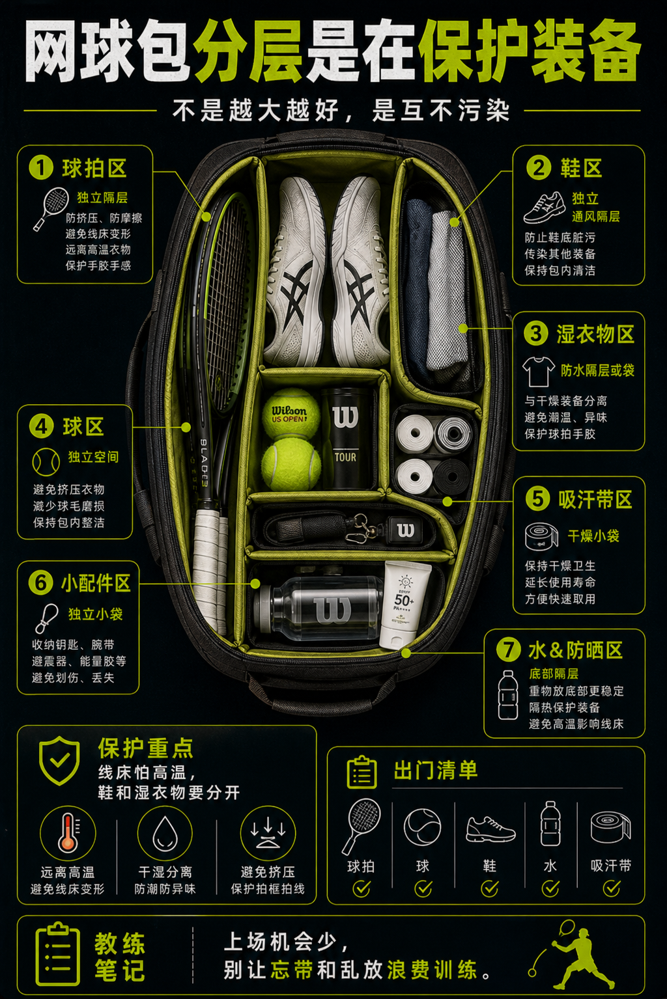

# 网球包分层是在保护装备

> 迁移草稿：保留原文供编辑核对，尚未完成面向球友的通用改写和逐条来源复核。

网球包不是越大越好，重点是让球拍、鞋、湿衣物、球和小配件互不污染。

## 概念说明

好的网球包分层能减少装备损耗：球拍和线床避免高温挤压，鞋和湿衣物不要和吸汗带、护腕混在一起，球、胶带、剪刀、防晒和水分区放。对少上场玩家，固定收纳还能减少忘带东西的概率，让每次珍贵场地时间更稳定。

## 配图

## 常见误区（原版素材）

所有东西混在一起，吸汗带湿、鞋脏、球拍暴晒。

## 理解自测（待编辑）

网球包分层为什么会影响训练质量？

## 相关词条

- [装备日志比玄学手感可靠](../equipment/equipment.maintenance.match-log.md)（application）
- [吸汗带周期要固定下来](../equipment/equipment.grip.change-cycle.md)（supporting）

## 来源与审核

- 内容状态：原版标记为 verified（本轮未逐条重新核实）。
- 原始内容：[content/atlas/cards/equipment-deep-dive.json](../../../atlas/cards/equipment-deep-dive.json)；ID：equipment.accessory.bag-organization。
- 证据类型：verified-source。
- 来源：[How to Choose a Tennis Bag](https://www.tennis-warehouse.com/learning_center/how_to/choose-a-tennis-bag.html)。
- 原版说明：Supports the bag-organization card on racquet sections, accessory pockets, shoe tunnels, water-bottle pockets and choosing a bag around what must be carried to court.
- 原版审核：Codex，2026-05-25。
- Wiki 编辑需检查措辞、适用条件、原版个人化断言及来源支持范围。
