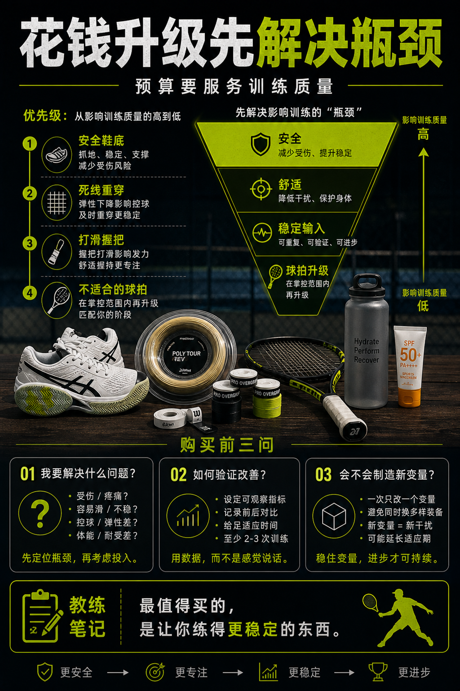

# 花钱升级要先解决瓶颈

> 迁移草稿：保留原文供编辑核对，尚未完成面向球友的通用改写和逐条来源复核。

装备预算应该优先花在明确瓶颈上：安全、舒适、稳定输入和可持续练习。

## 概念说明

最值得优先升级的，通常不是最闪的装备，而是正在限制你训练质量的东西：不安全的鞋、死掉的线、打滑的吸汗带、不合适的球拍重量、缺少防晒补水。每次花钱前先写一句：我要解决什么问题？如何验证？如果答不上来，就先记录和试用。

## 配图

## 常见误区（原版素材）

买新装备带来新鲜感，却没有解决真实问题。

## 理解自测（待编辑）

装备升级前，为什么必须先写清楚要解决的问题？

## 相关词条

- [装备日志比玄学手感可靠](../equipment/equipment.maintenance.match-log.md)（prerequisite）
- [换拍时机看瓶颈不是看心动](../equipment/equipment.racquet.upgrade-timing.md)（supporting）

## 来源与审核

- 内容状态：原版标记为 verified（本轮未逐条重新核实）。
- 原始内容：[content/atlas/cards/equipment-deep-dive.json](../../../atlas/cards/equipment-deep-dive.json)；ID：equipment.accessory.spend-upgrade。
- 证据类型：source-synthesis。
- 来源：Equipment setup variables require tracking across balls, strings, racquets and shoes — 2026-05-25 synthesis of Tennis Warehouse equipment guides and local training workflow。
- 原版说明：Supports the equipment-log and spend-upgrade cards: because balls, stringbed, racquet specs, shoes and weather all alter feedback, recording setup and outcomes is necessary before attributing performance changes to one cause.
- 原版审核：Codex，2026-05-25。
- Wiki 编辑需检查措辞、适用条件、原版个人化断言及来源支持范围。
