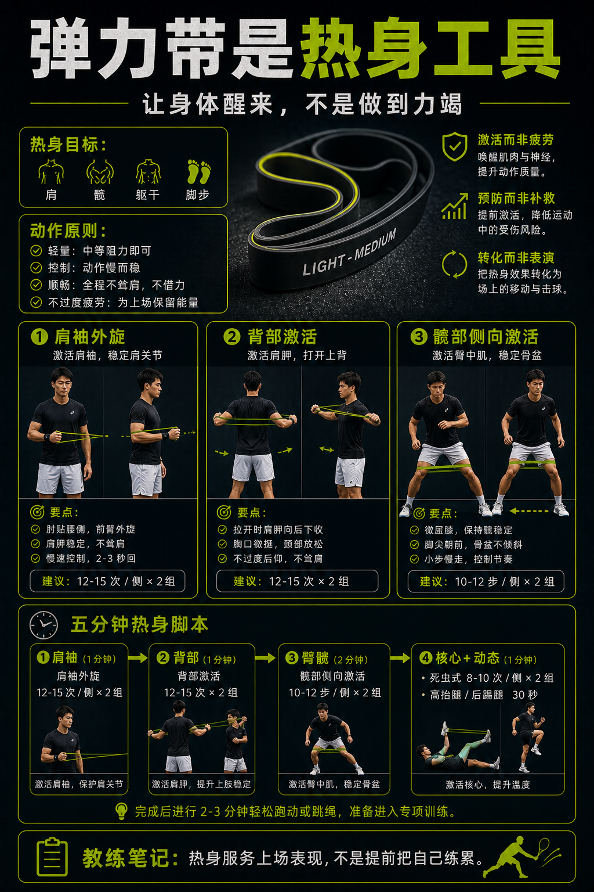

# 弹力带是热身工具不是表演

> 迁移草稿：保留原文供编辑核对，尚未完成面向球友的通用改写和逐条来源复核。

弹力带适合做肩、髋和核心激活，帮助身体进入网球动作，而不是临场硬拉大力量。

## 概念说明

网球需要肩、髋、躯干和脚步共同工作。弹力带可以用于轻量激活肩袖、背部、臀部和核心，让发球、正反手和横移前身体更醒。热身重点是控制、轻量和动作质量，不是把弹力带拉到力竭。它应该服务于上场表现和伤痛风险管理。

## 配图

## 常见误区（原版素材）

不热身直接发力，或者把热身做成疲劳训练。

## 理解自测（待编辑）

为什么热身弹力带不应该做到力竭？

## 相关词条

- [防晒和补水也是装备](../equipment/equipment.accessory.sun-hydration.md)（supporting）
- [Split 不是跳，是落地后能启动](../movement/spacing.split-timing.md)（application）

## 来源与审核

- 内容状态：原版标记为 verified（本轮未逐条重新核实）。
- 原始内容：[content/atlas/cards/equipment-deep-dive.json](../../../atlas/cards/equipment-deep-dive.json)；ID：equipment.accessory.warmup-band。
- 证据类型：verified-source。
- 来源：[Dynamic Warm-up and Flexibility Training for Tennis](https://www.usta.com/en/home/improve/tips-and-instruction/national/dynamic-warm-up-and-flexibility-training.print.html)。
- 原版说明：Supports the warm-up accessory card by grounding pre-practice preparation in dynamic warm-up and tennis-specific movement preparation.
- 原版审核：Codex，2026-05-25。
- Wiki 编辑需检查措辞、适用条件、原版个人化断言及来源支持范围。
