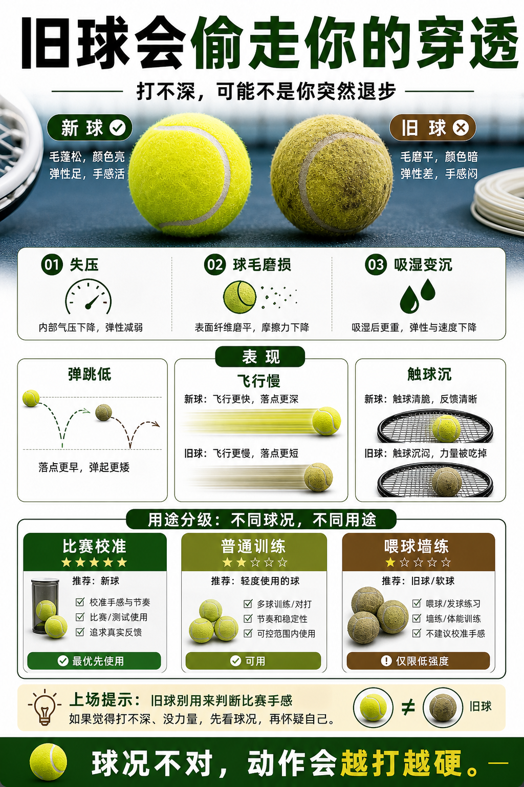

# 旧球会偷走你的穿透

> 迁移草稿：保留原文供编辑核对，尚未完成面向球友的通用改写和逐条来源复核。

旧球失压、球毛磨损或吸湿后会变慢变沉，容易让你误判自己的发力和击球质量。

## 概念说明

旧球并不只是变脏，它可能弹跳降低、飞行变慢、触球更沉，导致你需要更用力才能打深。长期用旧球练习容易让动作变硬，甚至为了追深度而过度发力。旧球可以用于低强度喂球和墙练，但不适合作为判断比赛手感和装备参数的唯一依据。

## 配图

## 常见误区（原版素材）

用死球练到动作越来越硬。

## 理解自测（待编辑）

旧球还能用，但为什么不能用来校准比赛手感？

## 相关词条

- [开罐时间会偷走你的比赛手感](../equipment/equipment.ball.lifespan.md)（supporting）
- [比赛球和训练球不是一回事](../equipment/equipment.ball.match-vs-training.md)（supporting）

## 来源与审核

- 内容状态：原版标记为 verified（本轮未逐条重新核实）。
- 原始内容：[content/atlas/cards/equipment-deep-dive.json](../../../atlas/cards/equipment-deep-dive.json)；ID：equipment.ball.dead-ball。
- 证据类型：verified-source。
- 来源：[How to Choose the Right Tennis Balls](https://www.tennis-warehouse.com/learning_center/how_to/choose_right_tennis_balls.html)。
- 原版说明：Supports the equipment-ball cards on pressurized versus pressureless balls, felt/core/air construction, regular and extra duty surface fit, high altitude balls, and how ball type changes bounce, durability and practice suitability.
- 原版审核：Codex，2026-05-25。
- Wiki 编辑需检查措辞、适用条件、原版个人化断言及来源支持范围。
