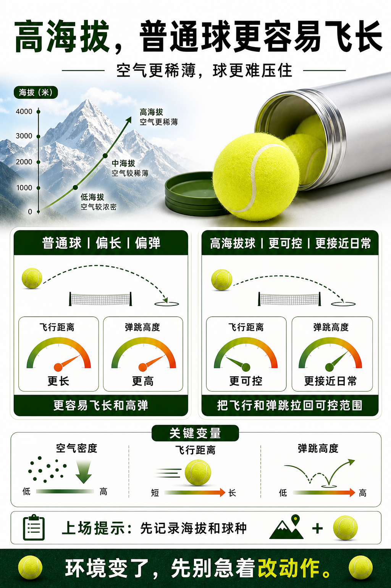

# 高海拔球是为了让球别飞疯

> 迁移草稿：保留原文供编辑核对，尚未完成面向球友的通用改写和逐条来源复核。

高海拔空气阻力更小，专用球会通过规格调整让飞行和弹跳更接近可控范围。

## 概念说明

海拔升高后空气密度降低，球在飞行中受到的阻力变小，更容易飞远、速度保持更久。高海拔用球的意义是把比赛体验拉回合理区间，而不是让球更快。普通球到了高海拔可能让你误判自己的力量和旋转，觉得球突然压不住。

## 配图

## 常见误区（原版素材）

到高海拔打球后怪自己控球突然变差。

## 理解自测（待编辑）

为什么高海拔环境会让同样击球更容易出界？

## 相关词条

- [同一颗球，到不同场地会变性格](../equipment/equipment.ball.surface.md)（supporting）
- [装备日志比玄学手感可靠](../equipment/equipment.maintenance.match-log.md)（application）

## 来源与审核

- 内容状态：原版标记为 verified（本轮未逐条重新核实）。
- 原始内容：[content/atlas/cards/equipment-deep-dive.json](../../../atlas/cards/equipment-deep-dive.json)；ID：equipment.ball.high-altitude。
- 证据类型：verified-source。
- 来源：[2026 ITF Approved Tennis Balls, Classified Surfaces & Recognised Courts](https://www.itftennis.com/media/15639/2026-technical-booklet.pdf)。
- 原版说明：Supports the regulatory distinction between approved ball types, including pressurised or pressureless balls and high-altitude recommendations above 1,219 m.
- 原版审核：Codex，2026-05-25。
- Wiki 编辑需检查措辞、适用条件、原版个人化断言及来源支持范围。
