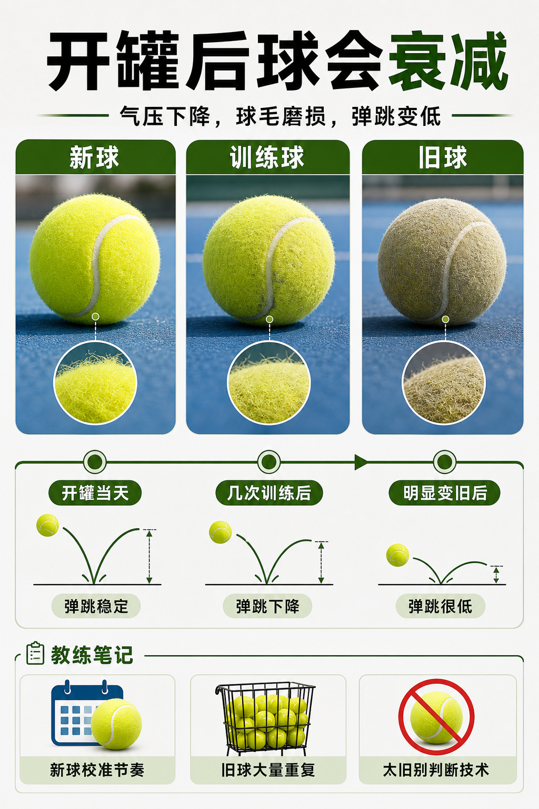

# 开罐时间会偷走你的比赛手感

> 迁移草稿：保留原文供编辑核对，尚未完成面向球友的通用改写和逐条来源复核。

球不是坏了才不能用，而是从开罐后就开始慢慢失去比赛节奏。

## 概念说明

压力球开罐后就开始和外界气压趋同，弹跳、声音、速度会逐步衰减。旧球仍然能练手感、脚步和控制，但不适合长期拿来判断发球速度、接发反应和比赛节奏。装备日志里记录开罐日期，比凭感觉说“这球还行”更可靠。对上场机会有限的人，最好把球分成比赛节奏球、普通训练球、喂球/墙练球三类。

## 配图

## 常见误区（原版素材）

同一批球用太久，练习质量下降却没有意识到。

## 理解自测（待编辑）

旧球是不是不能用？还是应该降级到合适的训练任务？

## 相关词条

- [压力球为什么更像比赛球](../equipment/equipment.ball.pressurized.md)（prerequisite）
- [装备日志比玄学手感可靠](../equipment/equipment.maintenance.match-log.md)（application）

## 来源与审核

- 内容状态：原版标记为 verified（本轮未逐条重新核实）。
- 原始内容：[content/atlas/cards/equipment-foundations.json](../../../atlas/cards/equipment-foundations.json)；ID：equipment.ball.lifespan。
- 证据类型：verified-source。
- 来源：[How to Choose the Right Tennis Balls](https://www.tennis-warehouse.com/learning_center/how_to/choose_right_tennis_balls.html)。
- 原版说明：Supports the equipment-ball cards on pressurized versus pressureless balls, felt/core/air construction, regular and extra duty surface fit, high altitude balls, and how ball type changes bounce, durability and practice suitability.
- 原版审核：Codex，2026-05-25。
- Wiki 编辑需检查措辞、适用条件、原版个人化断言及来源支持范围。
