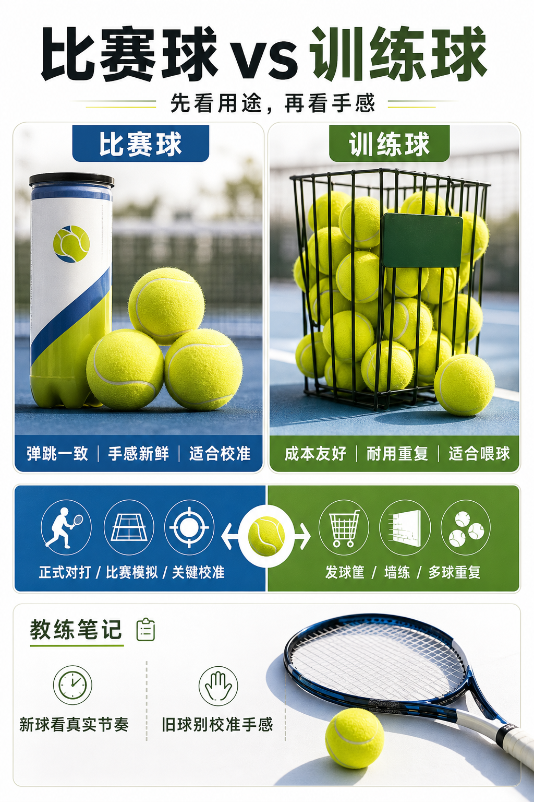

# 比赛球和训练球不是一回事

> 迁移草稿：保留原文供编辑核对，尚未完成面向球友的通用改写和逐条来源复核。

比赛球更强调一致弹跳和正式手感，训练球更强调成本、耐用和大量重复。

## 概念说明

比赛球通常追求更稳定的新球手感、弹跳和飞行表现，适合正式对打、比赛模拟和关键技术校准。训练球更适合大量喂球、发球筐和墙练，允许手感没那么新鲜，但成本和耐用更友好。不要用快坏的训练球判断自己真实击球质量，也不要把昂贵比赛球浪费在低强度重复喂球上。

## 配图

## 常见误区（原版素材）

用旧训练球练习后，以为自己击球没有穿透。

## 理解自测（待编辑）

什么时候值得开新球，什么时候用训练球就够？

## 相关词条

- [开罐时间会偷走你的比赛手感](../equipment/equipment.ball.lifespan.md)（supporting）
- [压力球为什么更像比赛球](../equipment/equipment.ball.pressurized.md)（prerequisite）

## 来源与审核

- 内容状态：原版标记为 verified（本轮未逐条重新核实）。
- 原始内容：[content/atlas/cards/equipment-deep-dive.json](../../../atlas/cards/equipment-deep-dive.json)；ID：equipment.ball.match-vs-training。
- 证据类型：verified-source。
- 来源：[How to Choose the Right Tennis Balls](https://www.tennis-warehouse.com/learning_center/how_to/choose_right_tennis_balls.html)。
- 原版说明：Supports the equipment-ball cards on pressurized versus pressureless balls, felt/core/air construction, regular and extra duty surface fit, high altitude balls, and how ball type changes bounce, durability and practice suitability.
- 原版审核：Codex，2026-05-25。
- Wiki 编辑需检查措辞、适用条件、原版个人化断言及来源支持范围。
