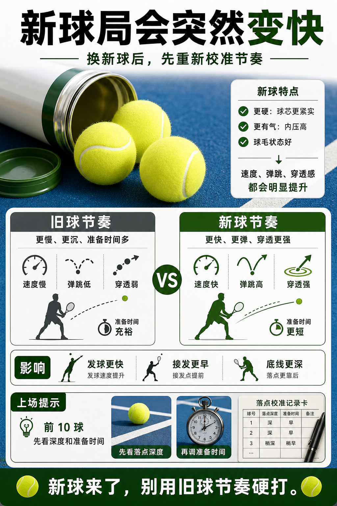

# 新球局会突然变快

> 迁移草稿：保留原文供编辑核对，尚未完成面向球友的通用改写和逐条来源复核。

新球更硬、更有气、更容易穿透，比赛里换新球会改变发球、接发和底线节奏。

## 概念说明

新球刚开罐时弹性和球毛状态更接近最佳，速度、弹跳和穿透感会比旧球明显。比赛换新球后，发球更容易拿到速度，接发准备要更早，底线球也可能更深。练习中如果从旧球切到新球，要给自己几分钟重新校准落点，而不是继续按旧球节奏发力。

## 配图

## 常见误区（原版素材）

新球局继续用旧球节奏，结果回球浅或出界。

## 理解自测（待编辑）

为什么比赛换新球后，接发准备要更早？

## 相关词条

- [压力球为什么更像比赛球](../equipment/equipment.ball.pressurized.md)（prerequisite）
- [接发的 split 跟着对手触球节奏](../technique/return.split-on-toss.md)（application）

## 来源与审核

- 内容状态：原版标记为 verified（本轮未逐条重新核实）。
- 原始内容：[content/atlas/cards/equipment-deep-dive.json](../../../atlas/cards/equipment-deep-dive.json)；ID：equipment.ball.new-ball-game。
- 证据类型：verified-source。
- 来源：[How to Choose the Right Tennis Balls](https://www.tennis-warehouse.com/learning_center/how_to/choose_right_tennis_balls.html)。
- 原版说明：Supports the equipment-ball cards on pressurized versus pressureless balls, felt/core/air construction, regular and extra duty surface fit, high altitude balls, and how ball type changes bounce, durability and practice suitability.
- 原版审核：Codex，2026-05-25。
- Wiki 编辑需检查措辞、适用条件、原版个人化断言及来源支持范围。
