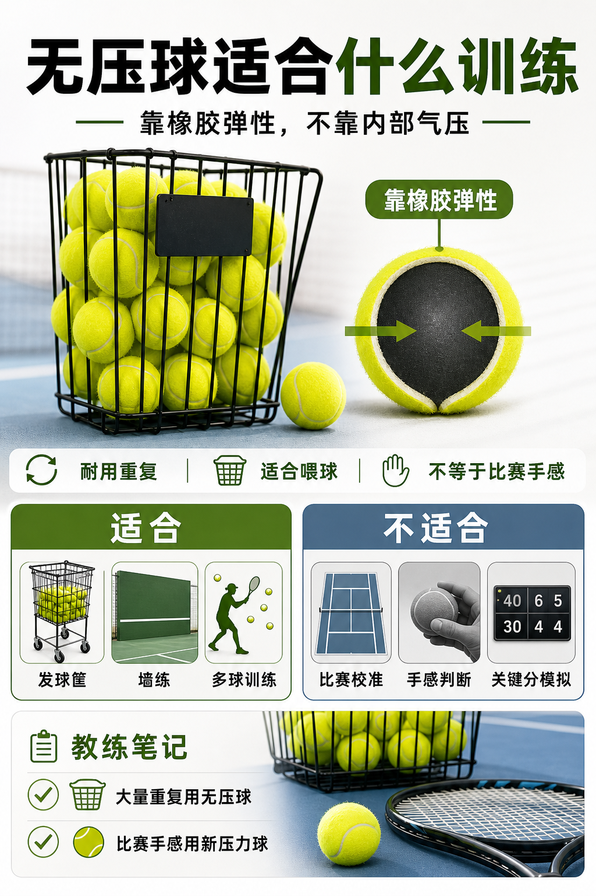

# 无压球适合训练，不等于适合比赛

> 迁移草稿：保留原文供编辑核对，尚未完成面向球友的通用改写和逐条来源复核。

无压球靠橡胶结构弹起，耐放耐用，适合重复喂球，但手感和比赛压力球不同。

## 概念说明

无压球没有靠内部高气压维持弹跳，更多依靠橡胶壳体本身回弹。它的优势是耐放、寿命长、适合球机、墙练和大量重复训练；劣势是出拍反馈、重量感和弹跳节奏往往不像正式压力球。对少上场的人，无压球可以降低耗材成本，但不要只用无压球建立比赛手感。越接近比赛的训练，越应该切回新鲜压力球校准节奏。

## 配图

## 常见误区（原版素材）

用无压球练得很多，却发现正式球更轻快、更容易顶到身体。

## 理解自测（待编辑）

无压球的优势是比赛还原度，还是耐用和重复训练？

## 相关词条

- [压力球为什么更像比赛球](../equipment/equipment.ball.pressurized.md)（supporting）
- [同一颗球，到不同场地会变性格](../equipment/equipment.ball.surface.md)（next）

## 来源与审核

- 内容状态：原版标记为 verified（本轮未逐条重新核实）。
- 原始内容：[content/atlas/cards/equipment-foundations.json](../../../atlas/cards/equipment-foundations.json)；ID：equipment.ball.pressureless。
- 证据类型：verified-source。
- 来源：[How to Choose the Right Tennis Balls](https://www.tennis-warehouse.com/learning_center/how_to/choose_right_tennis_balls.html)。
- 原版说明：Supports the equipment-ball cards on pressurized versus pressureless balls, felt/core/air construction, regular and extra duty surface fit, high altitude balls, and how ball type changes bounce, durability and practice suitability.
- 原版审核：Codex，2026-05-25。
- Wiki 编辑需检查措辞、适用条件、原版个人化断言及来源支持范围。
