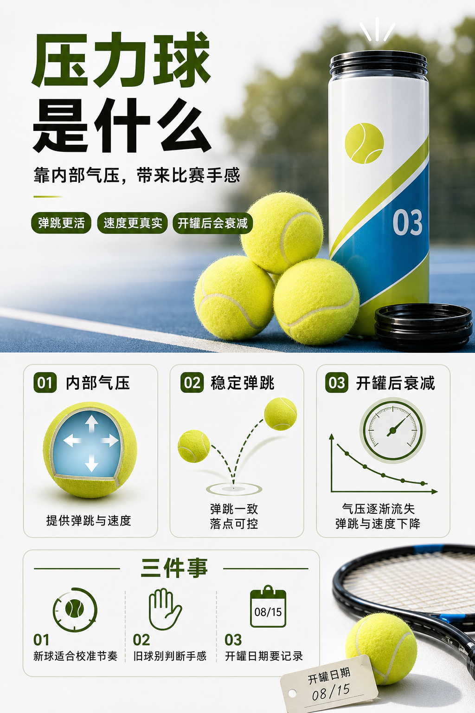

# 压力球为什么更像比赛球

> 迁移草稿：保留原文供编辑核对，尚未完成面向球友的通用改写和逐条来源复核。

压力球靠内部气压提供活力，弹跳和速度更接近正式比赛，但开罐后会持续衰减。

## 概念说明

大多数正式比赛使用压力球。它的核心不是外观看起来更新，而是内部气压会让球更有弹性，出拍更活、弹跳更接近比赛节奏。开罐后气压会慢慢流失，所以同一罐球从第一天到几周后，速度、弹跳高度和击球声音都会变化。练稳定性时可以接受旧球，但练发球、接发、比赛节奏时，太旧的压力球会让你的判断偏慢。

## 配图

## 常见误区（原版素材）

只看球毛新不新，不记录开罐时间，结果用失压球练比赛节奏。

## 理解自测（待编辑）

压力球和旧球的最大差别，是球毛颜色，还是内部气压带来的弹跳活力？

## 相关词条

- [开罐时间会偷走你的比赛手感](../equipment/equipment.ball.lifespan.md)（next）
- [无压球适合训练，不等于适合比赛](../equipment/equipment.ball.pressureless.md)（supporting）

## 来源与审核

- 内容状态：原版标记为 verified（本轮未逐条重新核实）。
- 原始内容：[content/atlas/cards/equipment-foundations.json](../../../atlas/cards/equipment-foundations.json)；ID：equipment.ball.pressurized。
- 证据类型：verified-source。
- 来源：[How to Choose the Right Tennis Balls](https://www.tennis-warehouse.com/learning_center/how_to/choose_right_tennis_balls.html)。
- 原版说明：Supports the equipment-ball cards on pressurized versus pressureless balls, felt/core/air construction, regular and extra duty surface fit, high altitude balls, and how ball type changes bounce, durability and practice suitability.
- 原版审核：Codex，2026-05-25。
- Wiki 编辑需检查措辞、适用条件、原版个人化断言及来源支持范围。
