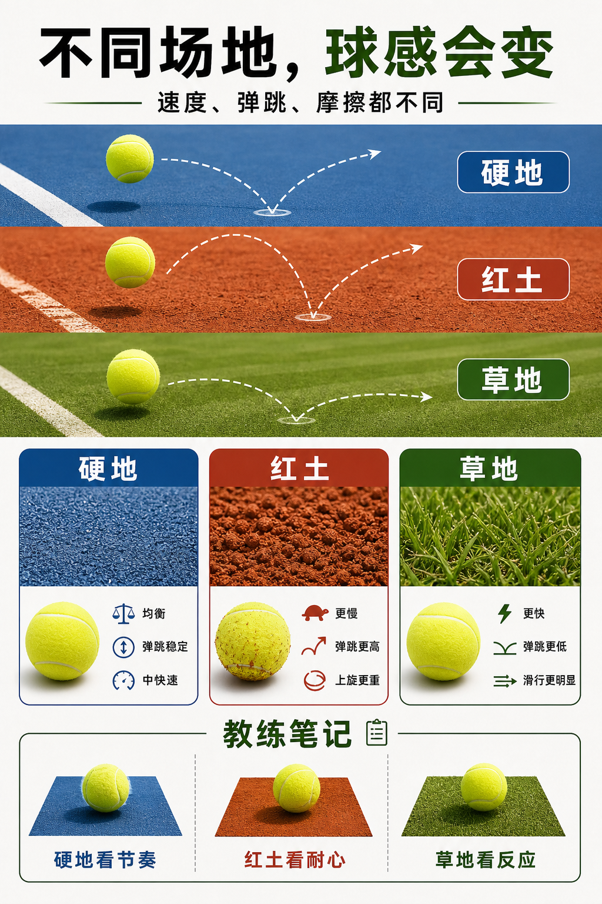

# 同一颗球，到不同场地会变性格

> 迁移草稿：保留原文供编辑核对，尚未完成面向球友的通用改写和逐条来源复核。

球感来自球和场地的组合：硬地、红土、草地会改变磨损、弹跳、速度和旋转反馈。

## 概念说明

装备不是孤立存在的。硬地会更直接地磨损球毛，反弹相对均衡；红土摩擦大，球毛沾土后更重，旋转和高弹更明显；草地让球更低、更快通过。你换场地后觉得球速和弹跳不一样，不一定是球变了，而是球和表层共同决定了来球性格。理解这一点，能帮你把装备选择、战术和预期放在同一张地图里。

## 配图

## 常见误区（原版素材）

换场地后还按旧节奏击球，结果不是被顶住就是被低球穿过。

## 理解自测（待编辑）

球感变化只来自球本身，还是来自球和场地表层的组合？

## 相关词条

- [球毛决定空气阻力和咬球感](../equipment/equipment.ball.felt.md)（supporting）
- [过网高度是你的安全预算](../ball-environment/trajectory.net-clearance.md)（application）

## 来源与审核

- 内容状态：原版标记为 verified（本轮未逐条重新核实）。
- 原始内容：[content/atlas/cards/equipment-foundations.json](../../../atlas/cards/equipment-foundations.json)；ID：equipment.ball.surface。
- 证据类型：verified-source。
- 来源：[How to Choose the Right Tennis Balls](https://www.tennis-warehouse.com/learning_center/how_to/choose_right_tennis_balls.html)。
- 原版说明：Supports the equipment-ball cards on pressurized versus pressureless balls, felt/core/air construction, regular and extra duty surface fit, high altitude balls, and how ball type changes bounce, durability and practice suitability.
- 原版审核：Codex，2026-05-25。
- Wiki 编辑需检查措辞、适用条件、原版个人化断言及来源支持范围。
