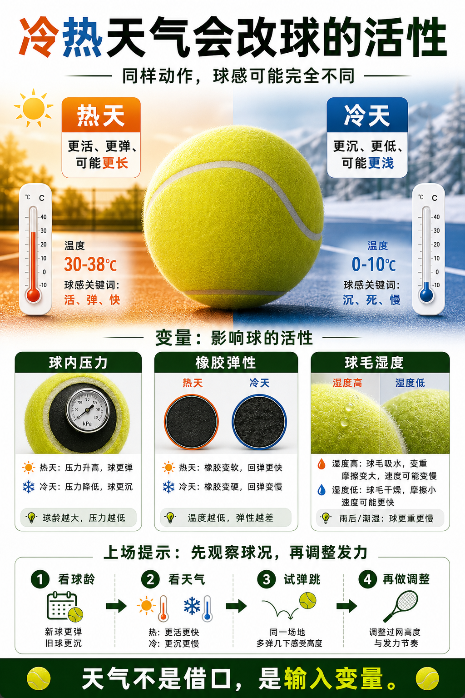

# 冷热天气会改球的活性

> 迁移草稿：保留原文供编辑核对，尚未完成面向球友的通用改写和逐条来源复核。

温度会影响球内压力、橡胶弹性和球毛状态，进而改变弹跳和出球速度。

## 概念说明

热天球通常更活、更弹，飞行和弹跳都可能更快；冷天球更容易显得沉、死、弹不起来。湿度和场地表面也会改变球毛和摩擦。天气不是借口，而是装备和环境变量。调整时先观察球况，再决定是加大过网高度、降低发力，还是换更新的球。

## 配图

## 常见误区（原版素材）

天气变化后马上怀疑技术退步。

## 理解自测（待编辑）

冷天球浅，是动作问题还是球活性问题？

## 相关词条

- [开罐时间会偷走你的比赛手感](../equipment/equipment.ball.lifespan.md)（supporting）
- [球毛决定空气阻力和咬球感](../equipment/equipment.ball.felt.md)（supporting）

## 来源与审核

- 内容状态：原版标记为 verified（本轮未逐条重新核实）。
- 原始内容：[content/atlas/cards/equipment-deep-dive.json](../../../atlas/cards/equipment-deep-dive.json)；ID：equipment.ball.temperature。
- 证据类型：verified-source。
- 来源：[How to Choose the Right Tennis Balls](https://www.tennis-warehouse.com/learning_center/how_to/choose_right_tennis_balls.html)。
- 原版说明：Supports the equipment-ball cards on pressurized versus pressureless balls, felt/core/air construction, regular and extra duty surface fit, high altitude balls, and how ball type changes bounce, durability and practice suitability.
- 原版审核：Codex，2026-05-25。
- Wiki 编辑需检查措辞、适用条件、原版个人化断言及来源支持范围。
