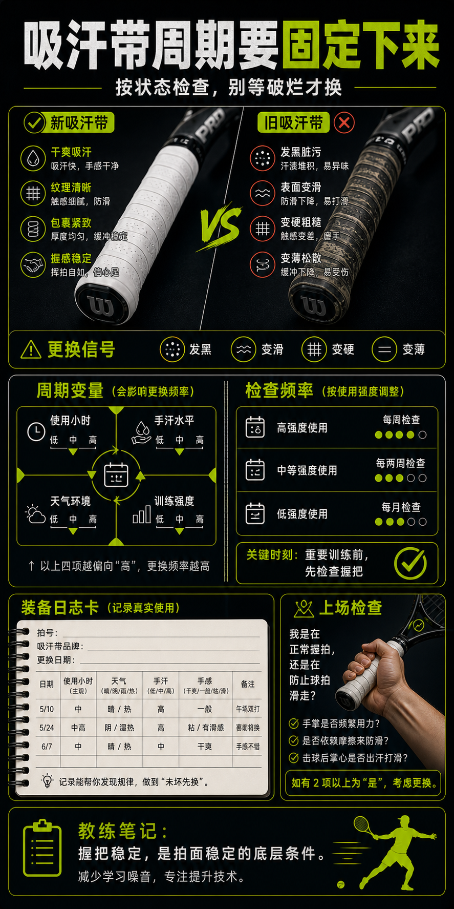

# 吸汗带周期要固定下来

> 迁移草稿：保留原文供编辑核对，尚未完成面向球友的通用改写和逐条来源复核。

吸汗带更换周期应该由使用小时、出汗和防滑状态决定，而不是等到破烂才换。

## 概念说明

吸汗带会被汗、摩擦和灰尘快速改变。等到它明显发黑、变滑或破损，通常已经影响握拍很久了。你可以按使用小时、天气和手汗建立周期，例如汗多季节更频繁更换，低频上场也要在关键练习前检查。稳定握把就是稳定拍面的底层条件。

## 配图

## 常见误区（原版素材）

吸汗带已经打滑，还继续怪自己拍面不稳。

## 理解自测（待编辑）

吸汗带为什么应该按周期换，而不是按脏不脏换？

## 相关词条

- [吸汗带是手感消耗品](../equipment/equipment.grip.overgrip.md)（prerequisite）
- [装备日志比玄学手感可靠](../equipment/equipment.maintenance.match-log.md)（application）

## 来源与审核

- 内容状态：原版标记为 verified（本轮未逐条重新核实）。
- 原始内容：[content/atlas/cards/equipment-deep-dive.json](../../../atlas/cards/equipment-deep-dive.json)；ID：equipment.grip.change-cycle。
- 证据类型：verified-source。
- 来源：[How To Change Your Tennis Overgrip](https://www.tennis-warehouse.com/learning_center/how_to/change_your_tennis_overgrip.html)。
- 原版说明：Supports cards that treat overgrips as replaceable hand-feel consumables and explain how wrapping tension, overlap and replacement affect handle feel.
- 原版审核：Codex，2026-05-25。
- Wiki 编辑需检查措辞、适用条件、原版个人化断言及来源支持范围。
