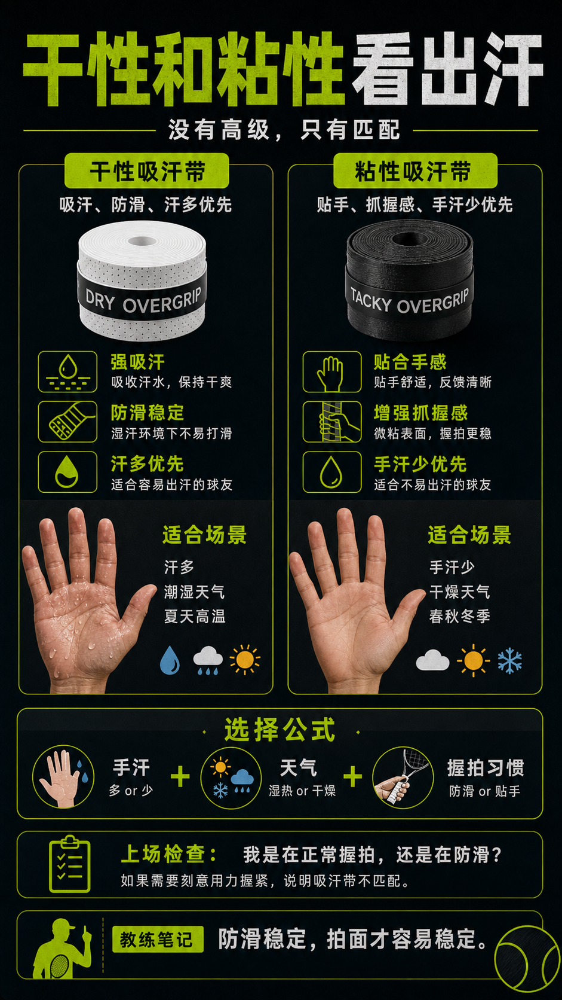

# 干性和粘性吸汗带看出汗

> 迁移草稿：保留原文供编辑核对，尚未完成面向球友的通用改写和逐条来源复核。

干性吸汗带更适合汗多和潮湿，粘性吸汗带更强调抓握感和贴手。

## 概念说明

吸汗带大致可以按干性和粘性理解。干性更像吸水和防滑，适合手汗多、潮湿或夏天；粘性更强调贴手和抓握感，适合手汗少或喜欢黏住球拍的人。没有绝对高级，只有你的出汗、天气和握拍习惯是否匹配。

## 配图

## 常见误区（原版素材）

手汗多还用不吸汗的胶，越打越紧。

## 理解自测（待编辑）

为什么吸汗带选择要看出汗和天气，而不是只看手感喜好？

## 相关词条

- [吸汗带是手感消耗品](../equipment/equipment.grip.overgrip.md)（prerequisite）
- [吸汗带周期要固定下来](../equipment/equipment.grip.change-cycle.md)（next）

## 来源与审核

- 内容状态：原版标记为 verified（本轮未逐条重新核实）。
- 原始内容：[content/atlas/cards/equipment-deep-dive.json](../../../atlas/cards/equipment-deep-dive.json)；ID：equipment.grip.dry-vs-tacky。
- 证据类型：verified-source。
- 来源：[Best Tennis Overgrips](https://www.tennis-warehouse.com/learning_center/gear_guides/tennis_racquets/best_overgrips.html)。
- 原版说明：Supports overgrip cards on tacky versus dry feel, overgrip replacement, slightly increasing grip size, and choosing grip feel by sweat and preference.
- 原版审核：Codex，2026-05-25。
- Wiki 编辑需检查措辞、适用条件、原版个人化断言及来源支持范围。
