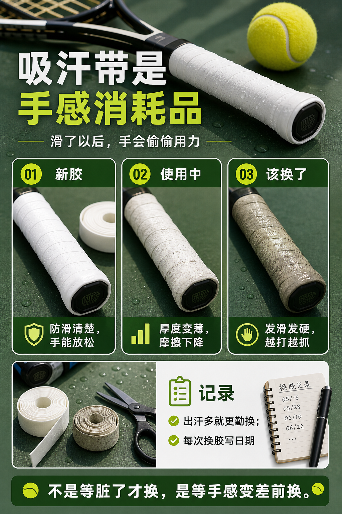

# 吸汗带是手感消耗品

> 迁移草稿：保留原文供编辑核对，尚未完成面向球友的通用改写和逐条来源复核。

吸汗带会磨损、变滑、变厚或变硬，应该按使用频率更换，而不是等到完全脏了才换。

## 概念说明

吸汗带影响防滑、握把粗细和触感。新胶太厚、旧胶太滑、汗多时失去摩擦，都会改变你对球拍的控制。很多拍面不稳和手臂紧张，其实来自你在下意识防止球拍滑动。把吸汗带当作消耗品，建立固定更换节奏，比临场硬抓更可靠。

## 配图

## 常见误区（原版素材）

球拍滑了还怪自己控拍差，继续越抓越紧。

## 理解自测（待编辑）

为什么吸汗带太滑会间接影响拍面稳定？

## 相关词条

- [手柄号决定放松还是硬抓](../equipment/equipment.grip.size.md)（supporting）
- [装备日志比玄学手感可靠](../equipment/equipment.maintenance.match-log.md)（application）

## 来源与审核

- 内容状态：原版标记为 verified（本轮未逐条重新核实）。
- 原始内容：[content/atlas/cards/equipment-extensions.json](../../../atlas/cards/equipment-extensions.json)；ID：equipment.grip.overgrip。
- 证据类型：verified-source。
- 来源：[Best Tennis Overgrips](https://www.tennis-warehouse.com/learning_center/gear_guides/tennis_racquets/best_overgrips.html)。
- 原版说明：Supports overgrip cards on tacky versus dry feel, overgrip replacement, slightly increasing grip size, and choosing grip feel by sweat and preference.
- 原版审核：Codex，2026-05-25。
- Wiki 编辑需检查措辞、适用条件、原版个人化断言及来源支持范围。
