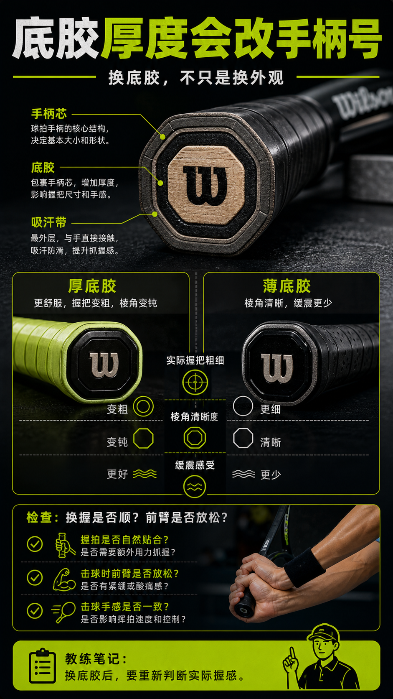

# 底胶厚度会改手柄号

> 迁移草稿：保留原文供编辑核对，尚未完成面向球友的通用改写和逐条来源复核。

更换底胶会改变握把粗细、缓震和棱角感，不能只当成外观维护。

## 概念说明

底胶在手柄和吸汗带之间，厚度、材质和压缩感会影响实际手柄号。厚底胶可能更舒服但让握把变粗、棱角变钝；薄底胶能保留清晰棱角，但缓震和舒适可能下降。换底胶后要重新判断握把大小，而不是只看球拍标注的手柄号。

## 配图

## 常见误区（原版素材）

换了厚底胶后还按原来的握法用力，结果手腕不顺。

## 理解自测（待编辑）

为什么换底胶后要重新判断手柄号？

## 相关词条

- [手柄号决定放松还是硬抓](../equipment/equipment.grip.size.md)（supporting）
- [握把形状会影响换握](../equipment/equipment.racquet.grip-shape.md)（supporting）

## 来源与审核

- 内容状态：原版标记为 verified（本轮未逐条重新核实）。
- 原始内容：[content/atlas/cards/equipment-deep-dive.json](../../../atlas/cards/equipment-deep-dive.json)；ID：equipment.grip.replacement-grip-thickness。
- 证据类型：verified-source。
- 来源：[Best Tennis Overgrips](https://www.tennis-warehouse.com/learning_center/gear_guides/tennis_racquets/best_overgrips.html)。
- 原版说明：Supports overgrip cards on tacky versus dry feel, overgrip replacement, slightly increasing grip size, and choosing grip feel by sweat and preference.
- 原版审核：Codex，2026-05-25。
- Wiki 编辑需检查措辞、适用条件、原版个人化断言及来源支持范围。
