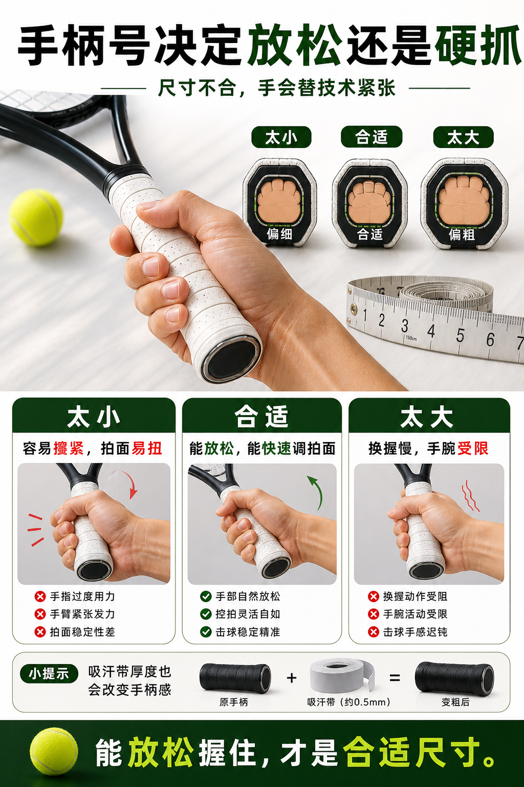

# 手柄号决定放松还是硬抓

> 迁移草稿：保留原文供编辑核对，尚未完成面向球友的通用改写和逐条来源复核。

手柄太大或太小都会影响放松握拍、手腕活动和拍面稳定。

## 概念说明

手柄号不是小细节。太小可能让你不自觉攥紧，击球时拍面容易扭；太大可能限制手腕和握法转换，让放松加速变困难。常见经验法可以作为初筛，但最终要结合握把胶厚度、手掌大小、握拍习惯和上场后的放松程度判断。

## 配图

## 常见误区（原版素材）

只看球拍参数，不检查手柄是否让自己越打越用力抓。

## 理解自测（待编辑）

为什么握把不合适会让你误以为自己技术紧？

## 相关词条

- [吸汗带是手感消耗品](../equipment/equipment.grip.overgrip.md)（next）
- [击球距离先判断太近、正好、太远](../movement/spacing.contact-distance.md)（application）

## 来源与审核

- 内容状态：原版标记为 verified（本轮未逐条重新核实）。
- 原始内容：[content/atlas/cards/equipment-extensions.json](../../../atlas/cards/equipment-extensions.json)；ID：equipment.grip.size。
- 证据类型：verified-source。
- 来源：[How to Measure Your Tennis Grip Size](https://www.tennis-warehouse.com/learning_center/how_to/how_to_measure_your_tennis_grip_size.html)。
- 原版说明：Supports grip-size cards on too-small and too-large handles, measuring methods, and using an overgrip when between sizes.
- 原版审核：Codex，2026-05-25。
- Wiki 编辑需检查措辞、适用条件、原版个人化断言及来源支持范围。
