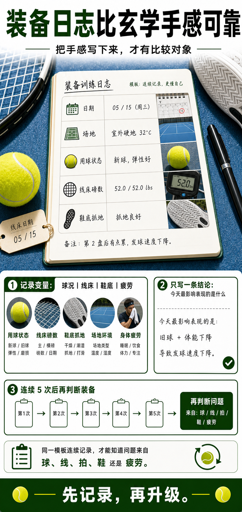

# 装备日志比玄学手感可靠

> 迁移草稿：保留原文供编辑核对，尚未完成面向球友的通用改写和逐条来源复核。

装备选择不能只靠当天感觉，记录球况、拍线、鞋底和上场表现，才能看出真正适合你的组合。

## 概念说明

装备日志是把主观手感变成可比较数据的方法。每次打球后记录日期、场地、用球状态、球拍、线种和磅数、鞋底抓地、身体疲劳、最明显的问题和一个结论。它不需要复杂，只要每次都用同一套字段。连续几周后，你会更容易分辨问题来自技术、球况、线床衰减、球拍参数还是鞋底磨损，而不是每次都重新猜。

## 配图

## 常见误区（原版素材）

今天打得好就觉得装备完美，今天打得差就想立刻换拍换线。

## 理解自测（待编辑）

今天表现变化，是技术变化，还是球、线、拍、鞋、疲劳这些变量变了？

## 相关词条

- [开罐时间会偷走你的比赛手感](../equipment/equipment.ball.lifespan.md)（supporting）
- [挥重才是挥起来的重量](../equipment/equipment.racquet.swingweight.md)（supporting）

## 来源与审核

- 内容状态：原版标记为 verified（本轮未逐条重新核实）。
- 原始内容：[content/atlas/cards/equipment-foundations.json](../../../atlas/cards/equipment-foundations.json)；ID：equipment.maintenance.match-log。
- 证据类型：source-synthesis。
- 来源：Equipment setup variables require tracking across balls, strings, racquets and shoes — 2026-05-25 synthesis of Tennis Warehouse equipment guides and local training workflow。
- 原版说明：Supports the equipment-log and spend-upgrade cards: because balls, stringbed, racquet specs, shoes and weather all alter feedback, recording setup and outcomes is necessary before attributing performance changes to one cause.
- 原版审核：Codex，2026-05-25。
- Wiki 编辑需检查措辞、适用条件、原版个人化断言及来源支持范围。
