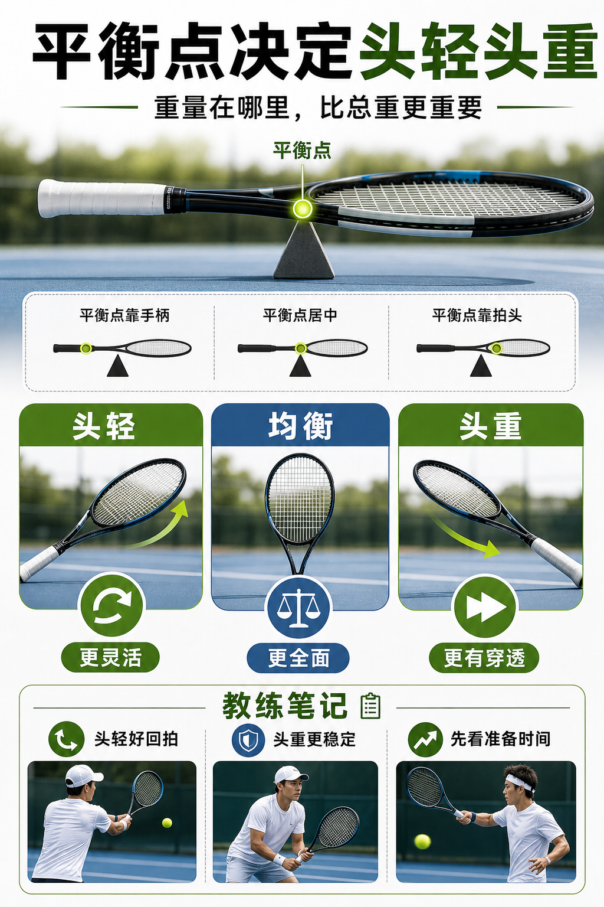

# 平衡点决定头轻还是头重

> 迁移草稿：保留原文供编辑核对，尚未完成面向球友的通用改写和逐条来源复核。

平衡点描述重量偏向拍头还是手柄，会改变灵活性、稳定性和击球穿透感。

## 概念说明

平衡点越靠拍头，球拍越有头重感，击球更容易借到惯性，但准备和变向会更慢；平衡点越靠手柄，球拍更灵活，网前和防守更容易调整，但对抗重球时可能需要你自己提供更多稳定。平衡点不是孤立参数，它和静态重量、挥重一起决定实际手感。选拍时不要只问“重不重”，还要问重量在哪里。

## 配图

## 常见误区（原版素材）

只觉得某支拍沉，却没分清是总重量沉还是拍头拖。

## 理解自测（待编辑）

两支同重量球拍为什么挥起来可能完全不同？

## 相关词条

- [静态重量不是挥起来的全部](../equipment/equipment.racquet.weight.md)（prerequisite）
- [挥重才是挥起来的重量](../equipment/equipment.racquet.swingweight.md)（next）

## 来源与审核

- 内容状态：原版标记为 verified（本轮未逐条重新核实）。
- 原始内容：[content/atlas/cards/equipment-foundations.json](../../../atlas/cards/equipment-foundations.json)；ID：equipment.racquet.balance。
- 证据类型：verified-source。
- 来源：[Tennis Racquet Weight, Balance, and Swingweight](https://twu.tennis-warehouse.com/learning_center/wtbalswt.php)。
- 原版说明：Supports the cards explaining static weight, balance and swingweight as distinct variables that change maneuverability, timing and impact stability.
- 原版审核：Codex，2026-05-25。
- Wiki 编辑需检查措辞、适用条件、原版个人化断言及来源支持范围。
