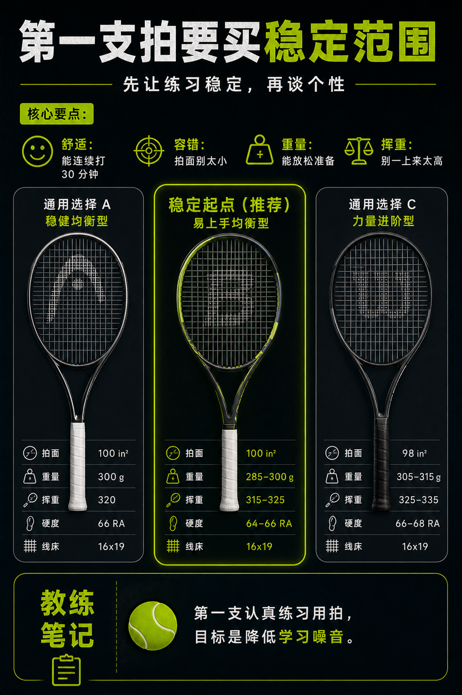

# 第一支拍要买稳定范围

> 迁移草稿：保留原文供编辑核对，尚未完成面向球友的通用改写和逐条来源复核。

第一支拍不该追极端参数，而要选择能支持学习、容错和连续练习的中性范围。

## 概念说明

第一支认真练习用拍，目标不是一步到位职业感，而是让你能放松、连续、稳定地建立动作。过重、过硬、过小拍面或过高挥重都会增加学习成本；过轻、过弹、过大力量也可能让拍面控制变模糊。中性、舒适、可持续练习的球拍，往往比参数极端的拍更适合作为起点。

## 配图

## 常见误区（原版素材）

照职业球员参数买拍，练两次就觉得自己不适合网球。

## 理解自测（待编辑）

第一支拍为什么不应该追求职业参数？

## 相关词条

- [拍面越大，甜区通常越宽](../equipment/equipment.racquet.head-size.md)（supporting）
- [静态重量不是挥起来的全部](../equipment/equipment.racquet.weight.md)（supporting）

## 来源与审核

- 内容状态：原版标记为 verified（本轮未逐条重新核实）。
- 原始内容：[content/atlas/cards/equipment-deep-dive.json](../../../atlas/cards/equipment-deep-dive.json)；ID：equipment.racquet.first-racquet。
- 证据类型：verified-source。
- 来源：[How to Pick the Right Tennis Racquet](https://www.tennis-warehouse.com/learning_center/gear_guides/tennis_racquets/selecting_the_right_tennis_racquet.html)。
- 原版说明：Supports beginner and intermediate racquet-selection cards on head size, stiffness, weight, balance, power/control tradeoffs and why player needs matter more than copying pro specs.
- 原版审核：Codex，2026-05-25。
- Wiki 编辑需检查措辞、适用条件、原版个人化断言及来源支持范围。
