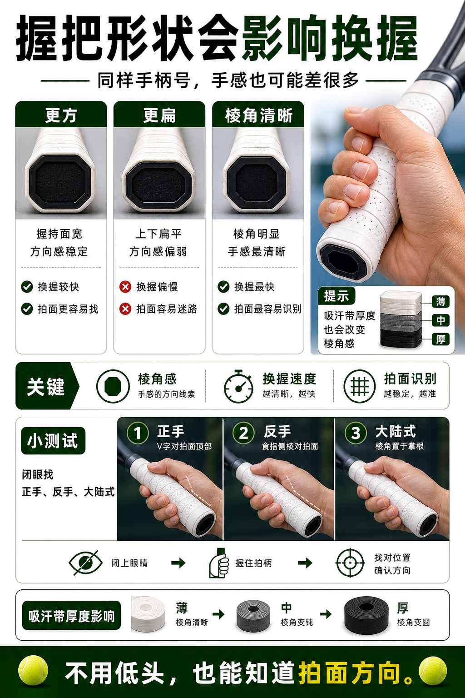

# 握把形状会影响换握

> 迁移草稿：保留原文供编辑核对，尚未完成面向球友的通用改写和逐条来源复核。

不同品牌和拍柄形状会改变棱角感、换握速度和拍面识别。

## 概念说明

握把形状不是只有粗细差异。有些拍柄更方，有些更扁，棱角清晰度也不同。棱角更清楚时，换握和拍面方向更容易被手感识别；形状不适合时，你可能觉得握法总是差一点、发球或截击拍面不稳定。它是很私人的适配项，需要结合握把胶厚度一起判断。

## 配图

## 常见误区（原版素材）

只看手柄号，不看握把形状是否适合自己的手。

## 理解自测（待编辑）

为什么同样手柄号，不同球拍握起来仍然差很多？

## 相关词条

- [手柄号决定放松还是硬抓](../equipment/equipment.grip.size.md)（supporting）
- [吸汗带是手感消耗品](../equipment/equipment.grip.overgrip.md)（supporting）

## 来源与审核

- 内容状态：原版标记为 verified（本轮未逐条重新核实）。
- 原始内容：[content/atlas/cards/equipment-deep-dive.json](../../../atlas/cards/equipment-deep-dive.json)；ID：equipment.racquet.grip-shape。
- 证据类型：verified-source。
- 来源：[Best Tennis Overgrips](https://www.tennis-warehouse.com/learning_center/gear_guides/tennis_racquets/best_overgrips.html)。
- 原版说明：Supports overgrip cards on tacky versus dry feel, overgrip replacement, slightly increasing grip size, and choosing grip feel by sweat and preference.
- 原版审核：Codex，2026-05-25。
- Wiki 编辑需检查措辞、适用条件、原版个人化断言及来源支持范围。
