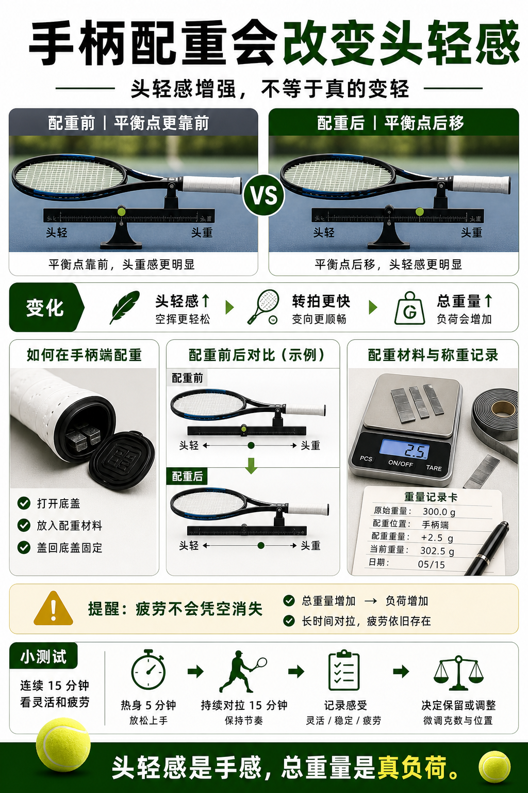

# 手柄配重会改变头轻感

> 迁移草稿：保留原文供编辑核对，尚未完成面向球友的通用改写和逐条来源复核。

手柄加重会增加总重量并让平衡点后移，可能提升头轻感，但不会让球拍真正变轻。

## 概念说明

在手柄端加重会让球拍平衡点靠后，空挥时可能更头轻、更好转拍。但总重量会上升，长时间对拉的疲劳并不会凭空消失。手柄配重适合微调操控和手感，不适合把一支明显不合适的拍强行改成另一种拍。

## 配图

## 常见误区（原版素材）

以为手柄配重能让球拍变轻，结果只是手感变了。

## 理解自测（待编辑）

为什么手柄加重会更头轻，但总负荷仍然增加？

## 相关词条

- [平衡点决定头轻还是头重](../equipment/equipment.racquet.balance.md)（prerequisite）
- [静态重量不是挥起来的全部](../equipment/equipment.racquet.weight.md)（supporting）

## 来源与审核

- 内容状态：原版标记为 verified（本轮未逐条重新核实）。
- 原始内容：[content/atlas/cards/equipment-deep-dive.json](../../../atlas/cards/equipment-deep-dive.json)；ID：equipment.racquet.handle-weight。
- 证据类型：verified-source。
- 来源：[Tennis Racquet Weight, Balance, and Swingweight](https://twu.tennis-warehouse.com/learning_center/wtbalswt.php)。
- 原版说明：Supports the cards explaining static weight, balance and swingweight as distinct variables that change maneuverability, timing and impact stability.
- 原版审核：Codex，2026-05-25。
- Wiki 编辑需检查措辞、适用条件、原版个人化断言及来源支持范围。
