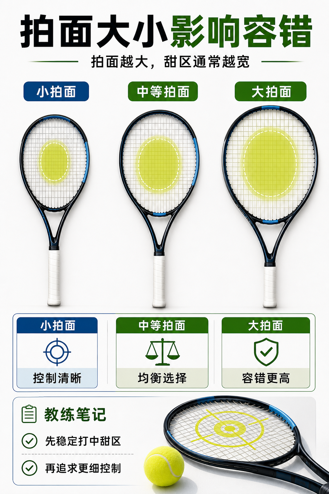

# 拍面越大，甜区通常越宽

> 迁移草稿：保留原文供编辑核对，尚未完成面向球友的通用改写和逐条来源复核。

拍面大小影响甜区和容错，但不是越大越高级；它是在稳定性、控制和手感之间取舍。

## 概念说明

拍面越大，通常越容易提供更宽的甜区和更高容错，偏心击球时更不容易完全失控。小拍面更强调反馈和精准，但对击球点、脚步和稳定性要求更高。对 2.7 到 3.5 阶段，拍面参数应该服务于稳定击中甜区，而不是模仿职业球员的小拍面。你真正要问的是：我现在需要更多容错，还是已经能稳定打到中心再追求更直接的反馈？

## 配图

## 常见误区（原版素材）

为了高级感选太小拍面，结果每次被动球都偏心失控。

## 理解自测（待编辑）

拍面大小解决的是面子问题，还是甜区和容错问题？

## 相关词条

- [静态重量不是挥起来的全部](../equipment/equipment.racquet.weight.md)（next）
- [击球距离先判断太近、正好、太远](../movement/spacing.contact-distance.md)（application）

## 来源与审核

- 内容状态：原版标记为 verified（本轮未逐条重新核实）。
- 原始内容：[content/atlas/cards/equipment-foundations.json](../../../atlas/cards/equipment-foundations.json)；ID：equipment.racquet.head-size。
- 证据类型：verified-source。
- 来源：[How to Pick the Right Tennis Racquet](https://www.tennis-warehouse.com/learning_center/gear_guides/tennis_racquets/selecting_the_right_tennis_racquet.html)。
- 原版说明：Supports beginner and intermediate racquet-selection cards on head size, stiffness, weight, balance, power/control tradeoffs and why player needs matter more than copying pro specs.
- 原版审核：Codex，2026-05-25。
- Wiki 编辑需检查措辞、适用条件、原版个人化断言及来源支持范围。
