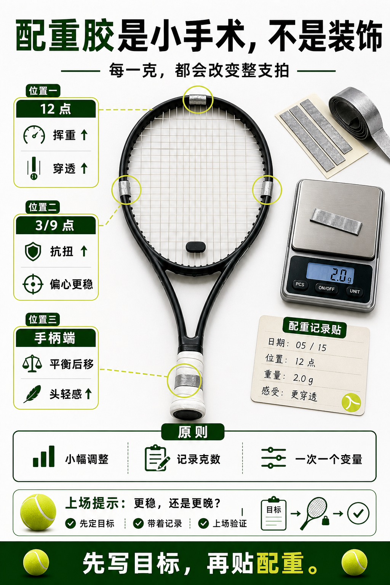

# 配重胶是小手术不是装饰

> 迁移草稿：保留原文供编辑核对，尚未完成面向球友的通用改写和逐条来源复核。

拍头、三九点和手柄配重会改变挥重、平衡和抗扭，必须小幅、可记录地调整。

## 概念说明

配重胶能改变球拍重量分布。拍头加重会提高穿透和挥重，三九点加重常用于提升抗扭稳定，手柄加重会让平衡点更靠后。配重不是免费升级，每一点重量都会改变准备时间和疲劳。正确做法是小幅调整、记录位置和重量、逐次试打，而不是一次贴满。

## 配图

## 常见误区（原版素材）

网上抄配重方案，不记录自己到底改善了什么。

## 理解自测（待编辑）

为什么配重必须一次只改一个变量？

## 相关词条

- [挥重才是挥起来的重量](../equipment/equipment.racquet.swingweight.md)（prerequisite）
- [装备日志比玄学手感可靠](../equipment/equipment.maintenance.match-log.md)（application）

## 来源与审核

- 内容状态：原版标记为 verified（本轮未逐条重新核实）。
- 原始内容：[content/atlas/cards/equipment-deep-dive.json](../../../atlas/cards/equipment-deep-dive.json)；ID：equipment.racquet.lead-tape。
- 证据类型：verified-source。
- 来源：[How to Customize Your Tennis Racquet's Weight and Balance](https://www.tennis-warehouse.com/learning_center/how_to/customize_your_tennis_racquet.html)。
- 原版说明：Supports the customization cards on lead/tungsten tape, handle weighting, balance changes, swingweight changes and the need for small, recorded adjustments.
- 原版审核：Codex，2026-05-25。
- Wiki 编辑需检查措辞、适用条件、原版个人化断言及来源支持范围。
