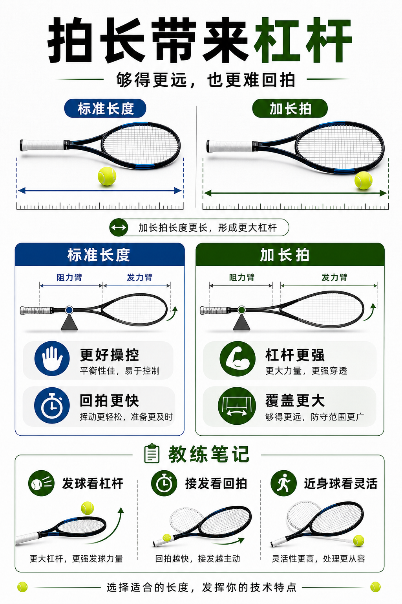

# 加长拍换来杠杆也换来难度

> 迁移草稿：保留原文供编辑核对，尚未完成面向球友的通用改写和逐条来源复核。

更长的球拍能增加触球半径和杠杆，但也会提高挥动、回拍和近身球处理难度。

## 概念说明

拍长影响覆盖范围、发球杠杆和挥动惯性。加长拍可能带来更强的发球和底线穿透，但挥重往往更高，近身球、接发和网前调整更难。对多数进阶前球员，标准长度更容易建立稳定击球点；加长拍更像专项取舍，不是默认升级。

## 配图

## 常见误区（原版素材）

为了发球威力上加长拍，却发现接发和近身球更乱。

## 理解自测（待编辑）

加长拍带来的杠杆优势，会在哪些球上变成负担？

## 相关词条

- [挥重才是挥起来的重量](../equipment/equipment.racquet.swingweight.md)（supporting）
- [平衡点决定头轻还是头重](../equipment/equipment.racquet.balance.md)（supporting）

## 来源与审核

- 内容状态：原版标记为 verified（本轮未逐条重新核实）。
- 原始内容：[content/atlas/cards/equipment-deep-dive.json](../../../atlas/cards/equipment-deep-dive.json)；ID：equipment.racquet.length。
- 证据类型：verified-source。
- 来源：[How to Pick the Right Tennis Racquet](https://www.tennis-warehouse.com/learning_center/gear_guides/tennis_racquets/selecting_the_right_tennis_racquet.html)。
- 原版说明：Supports beginner and intermediate racquet-selection cards on head size, stiffness, weight, balance, power/control tradeoffs and why player needs matter more than copying pro specs.
- 原版审核：Codex，2026-05-25。
- Wiki 编辑需检查措辞、适用条件、原版个人化断言及来源支持范围。
