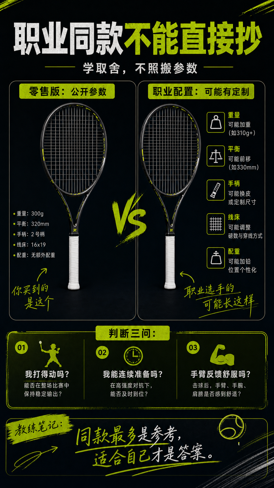

# 职业球员用拍不能直接抄

> 迁移草稿：保留原文供编辑核对，尚未完成面向球友的通用改写和逐条来源复核。

职业球员装备服务于他们的身体、训练量和定制需求，普通玩家照抄往往只会提高门槛。

## 概念说明

职业球员的拍可能有定制重量、平衡、手柄、线床和配重，并不一定等同于零售版本。更重要的是，他们的力量、挥速、准备时间和训练量远高于普通爱好者。学习职业球员可以学思路和取舍，但不应该把同款当成适合自己的证据。

## 配图

## 常见误区（原版素材）

买同款后发现打不动，还以为是自己太菜。

## 理解自测（待编辑）

为什么职业同款最多是参考，不是答案？

## 相关词条

- [挥重才是挥起来的重量](../equipment/equipment.racquet.swingweight.md)（supporting）
- [聚酯线给旋转也给门槛](../equipment/equipment.string.poly.md)（supporting）

## 来源与审核

- 内容状态：原版标记为 verified（本轮未逐条重新核实）。
- 原始内容：[content/atlas/cards/equipment-deep-dive.json](../../../atlas/cards/equipment-deep-dive.json)；ID：equipment.racquet.pro-player-myth。
- 证据类型：verified-source。
- 来源：[How to Pick the Right Tennis Racquet](https://www.tennis-warehouse.com/learning_center/gear_guides/tennis_racquets/selecting_the_right_tennis_racquet.html)。
- 原版说明：Supports beginner and intermediate racquet-selection cards on head size, stiffness, weight, balance, power/control tradeoffs and why player needs matter more than copying pro specs.
- 原版审核：Codex，2026-05-25。
- Wiki 编辑需检查措辞、适用条件、原版个人化断言及来源支持范围。
