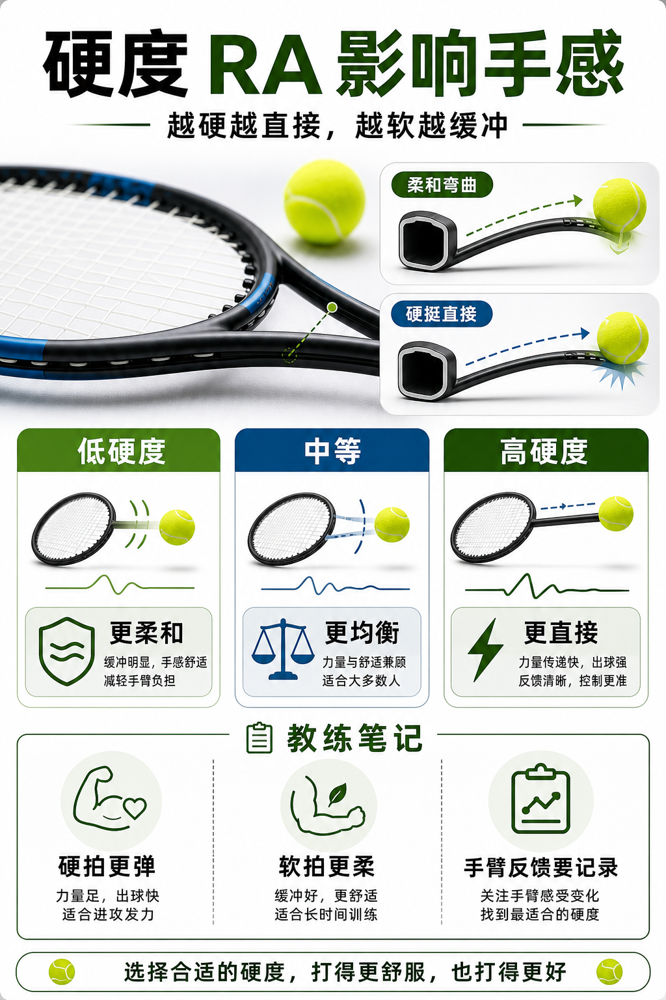

# 硬度 RA 影响力量和手感

> 迁移草稿：保留原文供编辑核对，尚未完成面向球友的通用改写和逐条来源复核。

球拍硬度描述拍框受力时弯曲多少，会影响力量反馈、控制感和手臂舒适度。

## 概念说明

硬度 RA 越高，拍框越不容易弯，击球反馈更直接，借力更明显，但震动和冲击也可能更明显；RA 越低，拍框形变更大，手感更柔和，控制和舒适性通常更友好，但免费力量可能少一些。硬度不能单独判断好坏，它会和线种、磅数、拍框厚度、击球甜区一起决定最终手感。

## 配图

## 常见误区（原版素材）

只追求出球快，忽略硬拍加硬线可能带来的冲击。

## 理解自测（待编辑）

球拍硬度和线床硬度，哪个更可能让你觉得震手？

## 相关词条

- [磅数不是越高越控](../equipment/equipment.string.tension.md)（supporting）
- [拍框厚度改变力量来源](../equipment/equipment.racquet.beam.md)（supporting）

## 来源与审核

- 内容状态：原版标记为 verified（本轮未逐条重新核实）。
- 原始内容：[content/atlas/cards/equipment-extensions.json](../../../atlas/cards/equipment-extensions.json)；ID：equipment.racquet.stiffness。
- 证据类型：verified-source。
- 来源：[How to Pick the Right Tennis Racquet](https://www.tennis-warehouse.com/learning_center/gear_guides/tennis_racquets/selecting_the_right_tennis_racquet.html)。
- 原版说明：Supports beginner and intermediate racquet-selection cards on head size, stiffness, weight, balance, power/control tradeoffs and why player needs matter more than copying pro specs.
- 原版审核：Codex，2026-05-25。
- Wiki 编辑需检查措辞、适用条件、原版个人化断言及来源支持范围。
