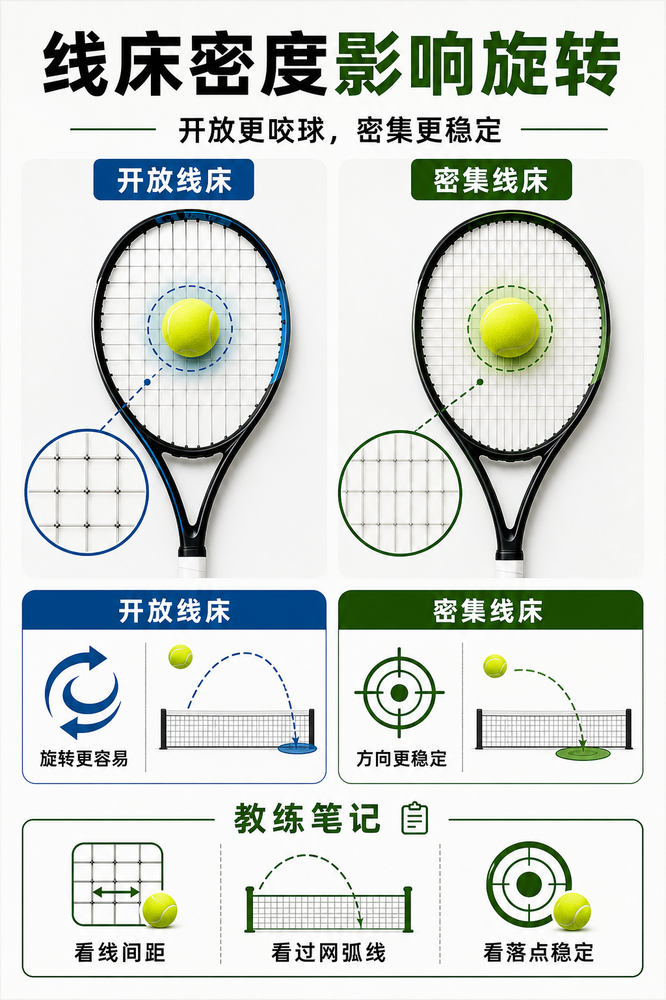

# 线床密度影响旋转和控制

> 迁移草稿：保留原文供编辑核对，尚未完成面向球友的通用改写和逐条来源复核。

开放线床更容易咬球和打出旋转，密集线床通常更稳定、更强调方向控制。

## 概念说明

线床密度指竖线和横线的数量与间距。开放线床如 16x19，线间距更大，球更容易陷入线床并产生线的回弹，有利于旋转和抛物线；密集线床如 18x20，线间距更小，出球更稳定，方向感更清楚，但对主动发力和击球质量要求更高。线床效果还会受到线种、线径和磅数影响。

## 配图

## 常见误区（原版素材）

把旋转不足全怪动作，没看线床和线种是否支持咬球。

## 理解自测（待编辑）

16x19 和 18x20 的差别，为什么不能只理解成线多线少？

## 相关词条

- [线径越细越咬球也越脆](../equipment/equipment.string.gauge.md)（supporting）
- [上旋是安全弧线，不是往上刷](../ball-environment/spin.topspin.md)（application）

## 来源与审核

- 内容状态：原版标记为 verified（本轮未逐条重新核实）。
- 原始内容：[content/atlas/cards/equipment-extensions.json](../../../atlas/cards/equipment-extensions.json)；ID：equipment.racquet.string-pattern。
- 证据类型：verified-source。
- 来源：[How to Pick the Right Tennis Racquet](https://www.tennis-warehouse.com/learning_center/gear_guides/tennis_racquets/selecting_the_right_tennis_racquet.html)。
- 原版说明：Supports beginner and intermediate racquet-selection cards on head size, stiffness, weight, balance, power/control tradeoffs and why player needs matter more than copying pro specs.
- 原版审核：Codex，2026-05-25。
- Wiki 编辑需检查措辞、适用条件、原版个人化断言及来源支持范围。
