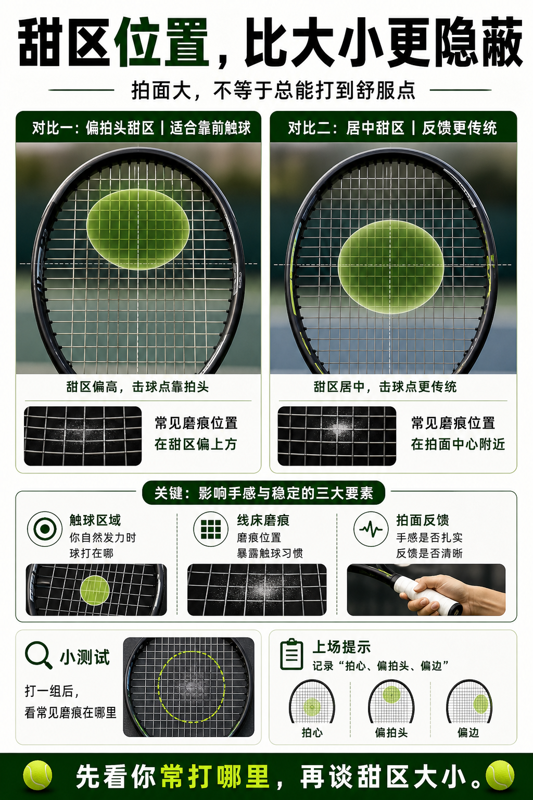

# 甜区位置比甜区大小更隐蔽

> 迁移草稿：保留原文供编辑核对，尚未完成面向球友的通用改写和逐条来源复核。

不同球拍不只是甜区大小不同，最舒服的击球区域位置也可能不同。

## 概念说明

甜区常被理解成容错面积，但位置同样重要。有的球拍甜区偏高，适合更靠拍头的现代击球；有的甜区更居中，反馈更传统。甜区位置不匹配时，你可能总觉得打不实，却不知道是触球点和球拍响应没对上。试拍时要观察自己自然触球落在拍面的哪里。

## 配图

## 常见误区（原版素材）

只问拍面大不大，不观察自己常打在哪里。

## 理解自测（待编辑）

为什么拍面大，不代表你一定总能打到最舒服的位置？

## 相关词条

- [拍面越大，甜区通常越宽](../equipment/equipment.racquet.head-size.md)（supporting）
- [击球距离先判断太近、正好、太远](../movement/spacing.contact-distance.md)（application）

## 来源与审核

- 内容状态：原版标记为 verified（本轮未逐条重新核实）。
- 原始内容：[content/atlas/cards/equipment-deep-dive.json](../../../atlas/cards/equipment-deep-dive.json)；ID：equipment.racquet.sweet-spot-location。
- 证据类型：verified-source。
- 来源：[Tennis Racquet Specs and Power Potential](https://twu.tennis-warehouse.com/learning_center/specsandspeed.php)。
- 原版说明：Supports the deeper racquet-spec cards on frame stiffness, sweet spot behavior, off-center response and how measured specs relate to on-court power and stability.
- 原版审核：Codex，2026-05-25。
- Wiki 编辑需检查措辞、适用条件、原版个人化断言及来源支持范围。
