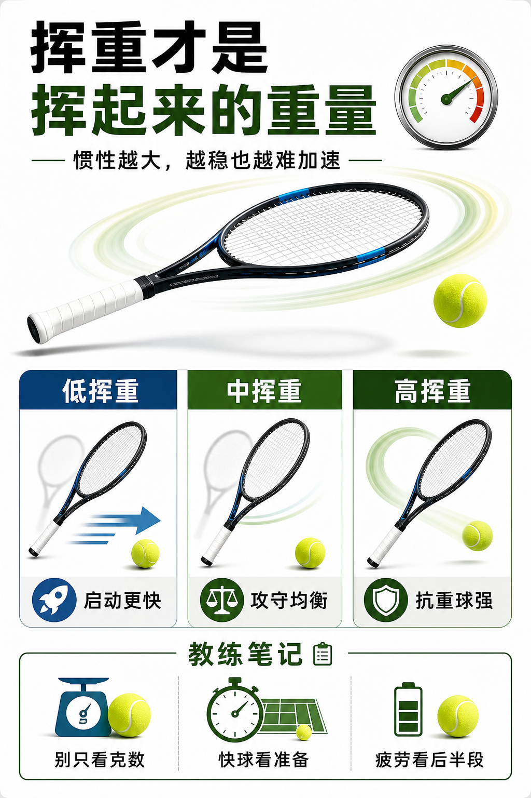

# 挥重才是挥起来的重量

> 迁移草稿：保留原文供编辑核对，尚未完成面向球友的通用改写和逐条来源复核。

挥重描述球拍绕手挥动时的惯性，比静态重量更接近你上场感受到的“好不好挥”。

## 概念说明

挥重高的球拍更能顶住来球、击球更有穿透，但启动、加速和临时变向更费力；挥重低的球拍更容易加速和调整，但面对重球时稳定性可能不足。它不是越高越职业，也不是越低越轻松，而是要匹配你的准备时间、力量和击球节奏。很多人买拍只看重量，却忽略挥重，结果发现纸面不重，上场却很拖。

## 配图

## 常见误区（原版素材）

追求职业感上高挥重，结果快球和被动球都来不及。

## 理解自测（待编辑）

为什么纸面重量不重的球拍，挥起来仍然可能拖？

## 相关词条

- [平衡点决定头轻还是头重](../equipment/equipment.racquet.balance.md)（prerequisite）
- [装备日志比玄学手感可靠](../equipment/equipment.maintenance.match-log.md)（application）

## 来源与审核

- 内容状态：原版标记为 verified（本轮未逐条重新核实）。
- 原始内容：[content/atlas/cards/equipment-foundations.json](../../../atlas/cards/equipment-foundations.json)；ID：equipment.racquet.swingweight。
- 证据类型：verified-source。
- 来源：[Tennis Racquet Weight, Balance, and Swingweight](https://twu.tennis-warehouse.com/learning_center/wtbalswt.php)。
- 原版说明：Supports the cards explaining static weight, balance and swingweight as distinct variables that change maneuverability, timing and impact stability.
- 原版审核：Codex，2026-05-25。
- Wiki 编辑需检查措辞、适用条件、原版个人化断言及来源支持范围。
