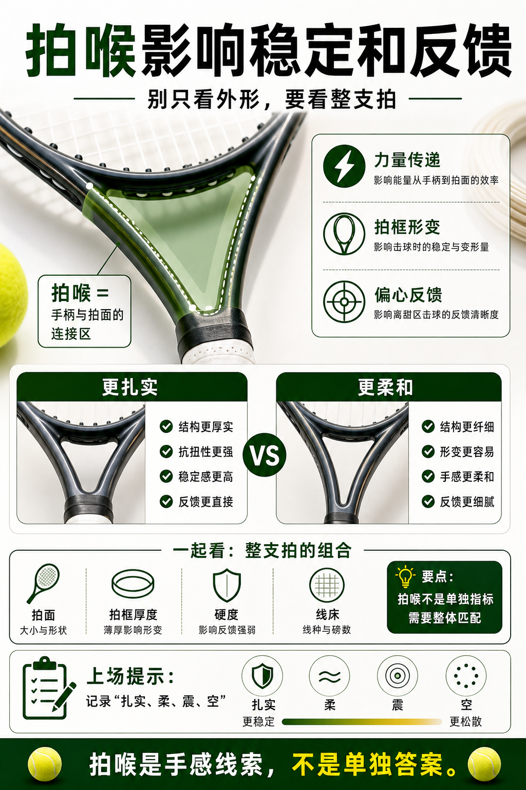

# 拍喉影响稳定和反馈

> 迁移草稿：保留原文供编辑核对，尚未完成面向球友的通用改写和逐条来源复核。

拍喉结构会影响拍框整体扭转、弯曲反馈和击球稳定，但要和整支拍一起理解。

## 概念说明

拍喉连接手柄与拍面，是力量传递和拍框形变的重要区域。更稳定的拍喉可能让击球反馈更扎实，开放或柔和的结构可能让手感更细腻。它不是单独选拍指标，因为拍面大小、拍框厚度、硬度和线床都会一起改变反馈。理解拍喉，是为了更好描述手感，不是为了盯着外形买拍。

## 配图

## 常见误区（原版素材）

把所有稳定感都归因于重量，忽略结构和线床。

## 理解自测（待编辑）

拍喉结构为什么不能脱离整支拍参数单独评价？

## 相关词条

- [拍框厚度改变力量来源](../equipment/equipment.racquet.beam.md)（supporting）
- [抗扭稳定决定偏心容错](../equipment/equipment.racquet.twistweight.md)（next）

## 来源与审核

- 内容状态：原版标记为 verified（本轮未逐条重新核实）。
- 原始内容：[content/atlas/cards/equipment-deep-dive.json](../../../atlas/cards/equipment-deep-dive.json)；ID：equipment.racquet.throat-stability。
- 证据类型：verified-source。
- 来源：[Tennis Racquet Specs and Power Potential](https://twu.tennis-warehouse.com/learning_center/specsandspeed.php)。
- 原版说明：Supports the deeper racquet-spec cards on frame stiffness, sweet spot behavior, off-center response and how measured specs relate to on-court power and stability.
- 原版审核：Codex，2026-05-25。
- Wiki 编辑需检查措辞、适用条件、原版个人化断言及来源支持范围。
