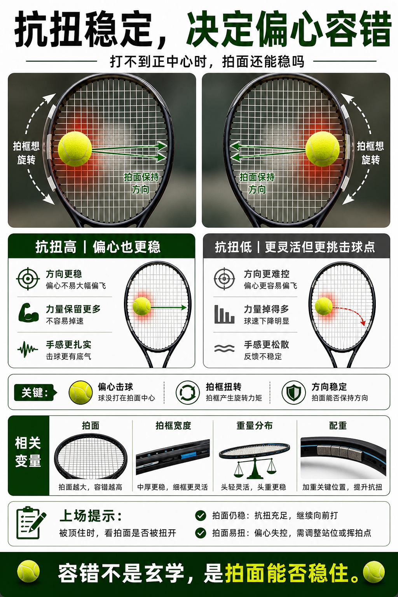

# 抗扭稳定决定偏心容错

> 迁移草稿：保留原文供编辑核对，尚未完成面向球友的通用改写和逐条来源复核。

抗扭稳定描述偏心击球时拍面抵抗旋转的能力，会影响方向稳定和容错。

## 概念说明

当球没有打在拍面中心，拍框会受到扭转。抗扭稳定更好的球拍更能保持拍面方向，偏心球也不容易大幅失控；抗扭弱的球拍可能更灵活，但偏心时方向和力量掉得更明显。它和拍面大小、拍框宽度、重量分布、配重都有关系。

## 配图

## 常见误区（原版素材）

把偏心失控全怪手感，没看拍框抗扭是否够。

## 理解自测（待编辑）

为什么抗扭稳定对防守和接发特别重要？

## 相关词条

- [甜区位置比甜区大小更隐蔽](../equipment/equipment.racquet.sweet-spot-location.md)（supporting）
- [配重胶是小手术不是装饰](../equipment/equipment.racquet.lead-tape.md)（next）

## 来源与审核

- 内容状态：原版标记为 verified（本轮未逐条重新核实）。
- 原始内容：[content/atlas/cards/equipment-deep-dive.json](../../../atlas/cards/equipment-deep-dive.json)；ID：equipment.racquet.twistweight。
- 证据类型：verified-source。
- 来源：[Tennis Racquet Specs and Power Potential](https://twu.tennis-warehouse.com/learning_center/specsandspeed.php)。
- 原版说明：Supports the deeper racquet-spec cards on frame stiffness, sweet spot behavior, off-center response and how measured specs relate to on-court power and stability.
- 原版审核：Codex，2026-05-25。
- Wiki 编辑需检查措辞、适用条件、原版个人化断言及来源支持范围。
