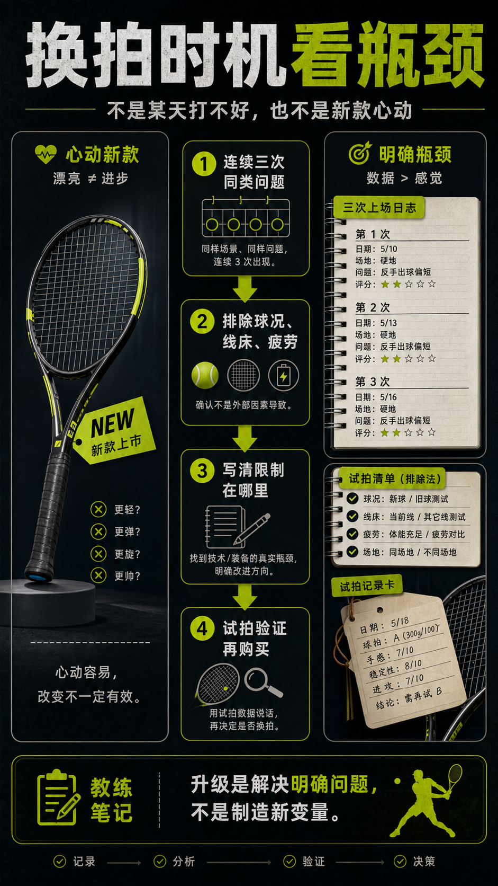

# 换拍时机看瓶颈不是看心动

> 迁移草稿：保留原文供编辑核对，尚未完成面向球友的通用改写和逐条来源复核。

真正该换拍，是现有球拍稳定地限制了你，而不是某次打不好或看到新款心动。

## 概念说明

换拍前先问：问题是否连续出现？是否排除了球况、线床、疲劳和技术执行？是否能明确说出现有拍限制在哪里，比如挥重太高、拍面太小、力量不足或手臂不适？如果答案不清楚，先用装备日志和试拍验证。升级不是消费仪式，而是解决明确瓶颈。

## 配图

## 常见误区（原版素材）

一打差就想换拍，一打好就觉得装备无敌。

## 理解自测（待编辑）

什么证据能说明这是装备瓶颈，而不是当天状态？

## 相关词条

- [装备日志比玄学手感可靠](../equipment/equipment.maintenance.match-log.md)（prerequisite）
- [第一支拍要买稳定范围](../equipment/equipment.racquet.first-racquet.md)（supporting）

## 来源与审核

- 内容状态：原版标记为 verified（本轮未逐条重新核实）。
- 原始内容：[content/atlas/cards/equipment-deep-dive.json](../../../atlas/cards/equipment-deep-dive.json)；ID：equipment.racquet.upgrade-timing。
- 证据类型：verified-source。
- 来源：[How to Pick the Right Tennis Racquet](https://www.tennis-warehouse.com/learning_center/gear_guides/tennis_racquets/selecting_the_right_tennis_racquet.html)。
- 原版说明：Supports beginner and intermediate racquet-selection cards on head size, stiffness, weight, balance, power/control tradeoffs and why player needs matter more than copying pro specs.
- 原版审核：Codex，2026-05-25。
- Wiki 编辑需检查措辞、适用条件、原版个人化断言及来源支持范围。
