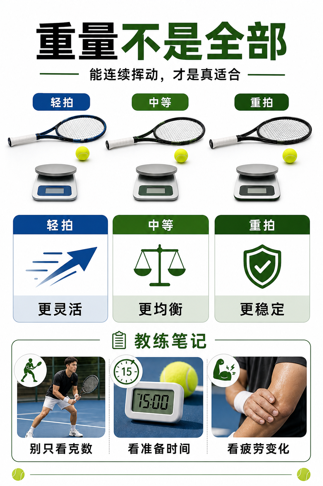

# 静态重量不是挥起来的全部

> 迁移草稿：保留原文供编辑核对，尚未完成面向球友的通用改写和逐条来源复核。

球拍标注的重量只是静态重量；真正上场还要看平衡点和挥重如何共同影响挥动。

## 概念说明

静态重量告诉你球拍放在秤上多重，但挥起来的感觉还取决于重量分布。两支同样 300 克的拍，头重的一支可能更难加速，头轻的一支可能更灵活。重量更大通常带来更好稳定性和抗冲击，但也更消耗体能和准备时间。对进阶阶段，重量选择要看你能不能在第三盘、被动球和连续来回中仍然按时挥拍。

## 配图

## 常见误区（原版素材）

只看克数买拍，忽略自己是否能连续按时挥动。

## 理解自测（待编辑）

球拍重量只看克数，还是要结合平衡点和连续挥拍能力？

## 相关词条

- [平衡点决定头轻还是头重](../equipment/equipment.racquet.balance.md)（next）
- [挥重才是挥起来的重量](../equipment/equipment.racquet.swingweight.md)（supporting）

## 来源与审核

- 内容状态：原版标记为 verified（本轮未逐条重新核实）。
- 原始内容：[content/atlas/cards/equipment-foundations.json](../../../atlas/cards/equipment-foundations.json)；ID：equipment.racquet.weight。
- 证据类型：verified-source。
- 来源：[Tennis Racquet Weight, Balance, and Swingweight](https://twu.tennis-warehouse.com/learning_center/wtbalswt.php)。
- 原版说明：Supports the cards explaining static weight, balance and swingweight as distinct variables that change maneuverability, timing and impact stability.
- 原版审核：Codex，2026-05-25。
- Wiki 编辑需检查措辞、适用条件、原版个人化断言及来源支持范围。
