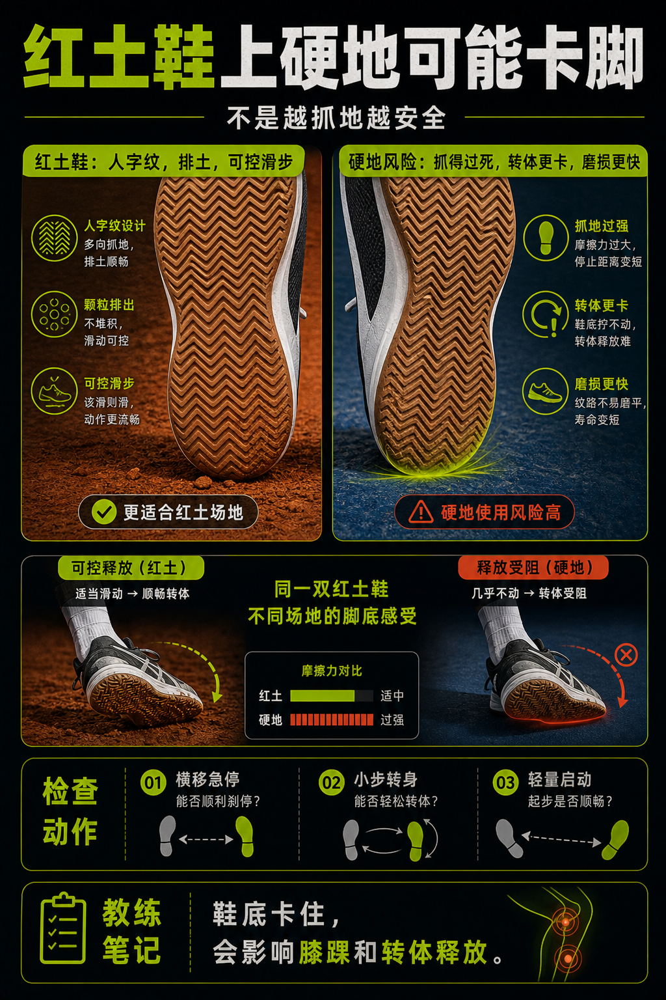

# 红土鞋上硬地可能卡脚

> 迁移草稿：保留原文供编辑核对，尚未完成面向球友的通用改写和逐条来源复核。

红土鞋的人字纹适合红土排土和滑动，但在硬地上可能抓得过死或磨损异常。

## 概念说明

红土鞋常用密集人字纹，帮助在颗粒场地上抓地、排土和可控滑步。到了硬地，这种外底可能抓地过强，让急停和转体更卡，也可能更快磨损。是否能临时使用要看具体鞋和场地，但不应该把红土鞋当硬地默认。

## 配图

## 常见误区（原版素材）

只觉得红土鞋抓地好，没发现硬地急停太卡。

## 理解自测（待编辑）

为什么鞋底抓地太强也可能是问题？

## 相关词条

- [鞋底纹路要匹配场地](../equipment/equipment.shoe.outsole.md)（prerequisite）
- [网球鞋要保护横向移动](../equipment/equipment.shoe.support.md)（supporting）

## 来源与审核

- 内容状态：原版标记为 verified（本轮未逐条重新核实）。
- 原始内容：[content/atlas/cards/equipment-deep-dive.json](../../../atlas/cards/equipment-deep-dive.json)；ID：equipment.shoe.clay-on-hard-court。
- 证据类型：verified-source。
- 来源：[How to Choose the Right Tennis Shoes](https://www.tennis-warehouse.com/learning_center/how_to/choosing_the_right_tennis_shoes.html)。
- 原版说明：Supports shoe cards on lateral stability, hard-court durability, clay herringbone outsoles, grass/synthetic-turf grip and selecting shoes by court surface.
- 原版审核：Codex，2026-05-25。
- Wiki 编辑需检查措辞、适用条件、原版个人化断言及来源支持范围。
