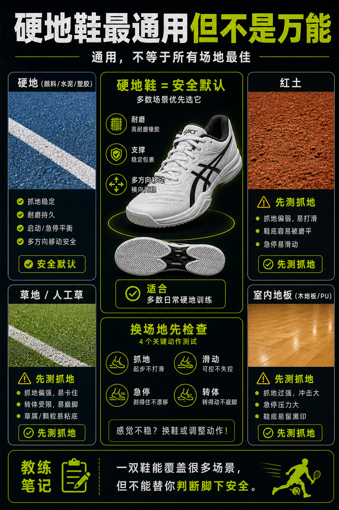

# 硬地鞋最通用但不是万能

> 迁移草稿：保留原文供编辑核对，尚未完成面向球友的通用改写和逐条来源复核。

硬地鞋因为耐磨和支撑均衡，常是最通用选择，但在红土、草地和人工草上仍要看抓地。

## 概念说明

硬地是最常见也最磨鞋的场地，所以硬地鞋通常强调耐磨、支撑和多方向移动。它可以覆盖很多日常场景，但不代表所有场地都最佳。红土需要可控滑动和排土，草地和人工草需要不同抓地逻辑。通用意味着不容易错，不等于每种场地表现都最好。

## 配图

## 常见误区（原版素材）

一双鞋打所有场地，却不观察抓地和滑动是否合适。

## 理解自测（待编辑）

为什么硬地鞋可以做默认，但不能无脑打所有场地？

## 相关词条

- [鞋底纹路要匹配场地](../equipment/equipment.shoe.outsole.md)（prerequisite）
- [东京人工草要重视砂和滑](../equipment/equipment.shoe.tokyo-artificial-grass.md)（next）

## 来源与审核

- 内容状态：原版标记为 verified（本轮未逐条重新核实）。
- 原始内容：[content/atlas/cards/equipment-deep-dive.json](../../../atlas/cards/equipment-deep-dive.json)；ID：equipment.shoe.hard-court-universal。
- 证据类型：verified-source。
- 来源：[How to Choose the Right Tennis Shoes](https://www.tennis-warehouse.com/learning_center/how_to/choosing_the_right_tennis_shoes.html)。
- 原版说明：Supports shoe cards on lateral stability, hard-court durability, clay herringbone outsoles, grass/synthetic-turf grip and selecting shoes by court surface.
- 原版审核：Codex，2026-05-25。
- Wiki 编辑需检查措辞、适用条件、原版个人化断言及来源支持范围。
