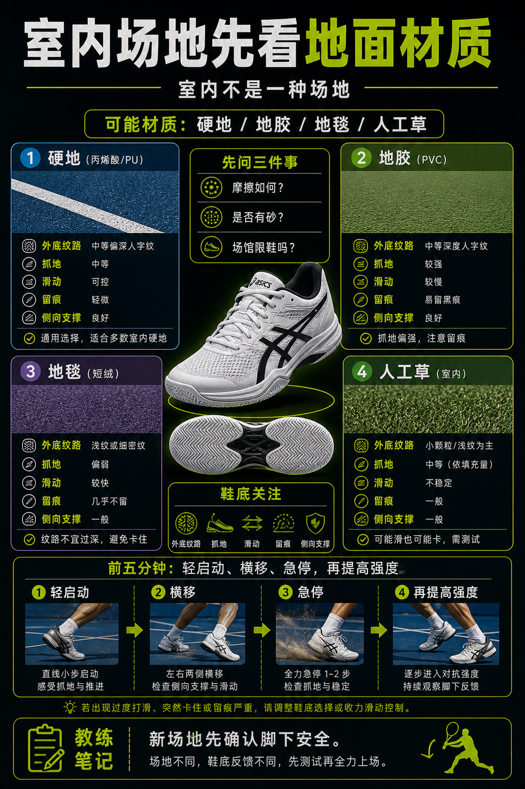

# 室内场地先看地面材质

> 迁移草稿：保留原文供编辑核对，尚未完成面向球友的通用改写和逐条来源复核。

室内不等于一种场地，地胶、硬地、地毯和人工草都需要不同抓地判断。

## 概念说明

室内网球可能是硬地、地毯、地胶或人工草，鞋底选择不能只看是否在室内。真正要看的是地面摩擦、是否有砂、是否容易滑、场馆是否限制鞋底类型。第一次去新室内场，先做低强度启动和急停检查，再逐渐提高移动强度。

## 配图

## 常见误区（原版素材）

听到室内就默认同一种鞋，忽略地面材质差异。

## 理解自测（待编辑）

为什么室内场地不能直接推导出鞋底选择？

## 相关词条

- [鞋底纹路要匹配场地](../equipment/equipment.shoe.outsole.md)（supporting）
- [硬地鞋最通用但不是万能](../equipment/equipment.shoe.hard-court-universal.md)（supporting）

## 来源与审核

- 内容状态：原版标记为 verified（本轮未逐条重新核实）。
- 原始内容：[content/atlas/cards/equipment-deep-dive.json](../../../atlas/cards/equipment-deep-dive.json)；ID：equipment.shoe.indoor-court-choice。
- 证据类型：verified-source。
- 来源：[How to Choose the Right Tennis Shoes](https://www.tennis-warehouse.com/learning_center/how_to/choosing_the_right_tennis_shoes.html)。
- 原版说明：Supports shoe cards on lateral stability, hard-court durability, clay herringbone outsoles, grass/synthetic-turf grip and selecting shoes by court surface.
- 原版审核：Codex，2026-05-25。
- Wiki 编辑需检查措辞、适用条件、原版个人化断言及来源支持范围。
