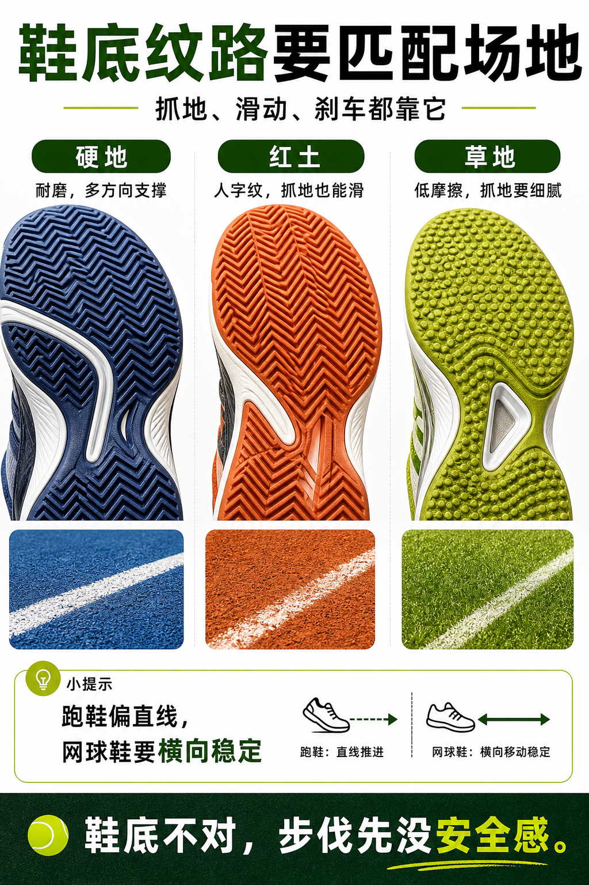

# 鞋底纹路要匹配场地

> 迁移草稿：保留原文供编辑核对，尚未完成面向球友的通用改写和逐条来源复核。

网球鞋外底不是装饰，硬地、红土、草地需要不同抓地和滑动策略。

## 概念说明

硬地鞋通常重视耐磨和多方向支撑；红土鞋常见人字纹外底，帮助在颗粒场地上抓地并可控滑动；草地鞋需要在低摩擦草面上提供抓地，但又不能破坏场地。穿错外底可能让你滑不动、停不住，或者在启动时失去安全感。

## 配图

## 常见误区（原版素材）

用跑鞋或不合场地的鞋打球，结果急停横移都不敢做。

## 理解自测（待编辑）

为什么跑鞋不适合替代网球鞋？

## 相关词条

- [网球鞋要保护横向移动](../equipment/equipment.shoe.support.md)（next）
- [Split 不是跳，是落地后能启动](../movement/spacing.split-timing.md)（application）

## 来源与审核

- 内容状态：原版标记为 verified（本轮未逐条重新核实）。
- 原始内容：[content/atlas/cards/equipment-extensions.json](../../../atlas/cards/equipment-extensions.json)；ID：equipment.shoe.outsole。
- 证据类型：verified-source。
- 来源：[How to Choose the Right Tennis Shoes](https://www.tennis-warehouse.com/learning_center/how_to/choosing_the_right_tennis_shoes.html)。
- 原版说明：Supports shoe cards on lateral stability, hard-court durability, clay herringbone outsoles, grass/synthetic-turf grip and selecting shoes by court surface.
- 原版审核：Codex，2026-05-25。
- Wiki 编辑需检查措辞、适用条件、原版个人化断言及来源支持范围。
