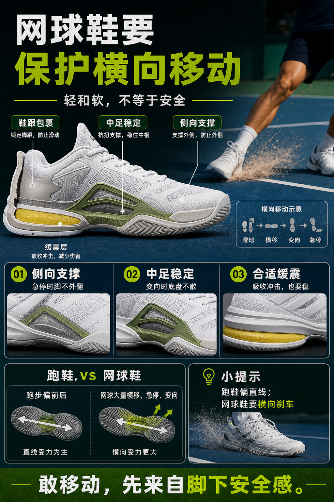

# 网球鞋要保护横向移动

> 迁移草稿：保留原文供编辑核对，尚未完成面向球友的通用改写和逐条来源复核。

网球有大量横移、急停和变向，鞋子的侧向支撑比单纯轻便更重要。

## 概念说明

跑步主要是前后方向，网球则充满横向启动、分腿垫步、急停、交叉步和回位。好的网球鞋会在外底、鞋面和中足结构上提供侧向支撑，减少脚在鞋内滑动和翻转风险。缓震重要，但不能只追软；太软太高的鞋可能让横向稳定变差。

## 配图

## 常见误区（原版素材）

只买轻和软，忽略横移时脚是否被稳定包住。

## 理解自测（待编辑）

为什么网球鞋不能只看轻、软、好走？

## 相关词条

- [鞋底纹路要匹配场地](../equipment/equipment.shoe.outsole.md)（supporting）
- [Split 不是跳，是落地后能启动](../movement/spacing.split-timing.md)（application）

## 来源与审核

- 内容状态：原版标记为 verified（本轮未逐条重新核实）。
- 原始内容：[content/atlas/cards/equipment-extensions.json](../../../atlas/cards/equipment-extensions.json)；ID：equipment.shoe.support。
- 证据类型：verified-source。
- 来源：[How to Choose the Right Tennis Shoes](https://www.tennis-warehouse.com/learning_center/how_to/choosing_the_right_tennis_shoes.html)。
- 原版说明：Supports shoe cards on lateral stability, hard-court durability, clay herringbone outsoles, grass/synthetic-turf grip and selecting shoes by court surface.
- 原版审核：Codex，2026-05-25。
- Wiki 编辑需检查措辞、适用条件、原版个人化断言及来源支持范围。
