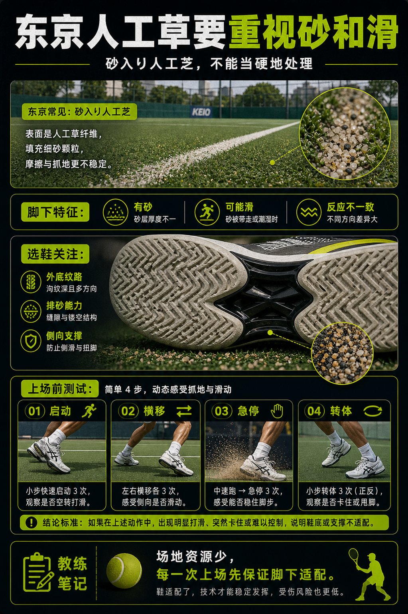

# 东京人工草要重视砂和滑

> 迁移草稿：保留原文供编辑核对，尚未完成面向球友的通用改写和逐条来源复核。

东京常见砂入り人工芝和人工草场地，脚下体验可能介于滑、卡和颗粒摩擦之间。

## 概念说明

日本很多公共场地是砂入り人工芝或类似人工草系统，表面有砂，和纯硬地差异很大。它可能比硬地更滑，也可能在某些方向突然抓住鞋底。选择鞋时要关注外底纹路、排砂、侧向支撑和自己是否能安全急停。第一次去场地，先测试再全速打。

## 配图

## 常见误区（原版素材）

拿硬地经验套人工草，启动和急停都不稳。

## 理解自测（待编辑）

为什么砂入り人工芝不能简单当硬地处理？

## 相关词条

- [鞋底纹路要匹配场地](../equipment/equipment.shoe.outsole.md)（prerequisite）
- [装备日志比玄学手感可靠](../equipment/equipment.maintenance.match-log.md)（application）

## 来源与审核

- 内容状态：原版标记为 verified（本轮未逐条重新核实）。
- 原始内容：[content/atlas/cards/equipment-deep-dive.json](../../../atlas/cards/equipment-deep-dive.json)；ID：equipment.shoe.tokyo-artificial-grass。
- 证据类型：repeated-training-observation。
- 来源：Tokyo artificial-grass and sand court planning observation — 2026-05-25 local Tokyo court-surface planning observation。
- 原版说明：Supports the Tokyo artificial-grass card as a local-context caution: for sand-filled artificial grass or similar surfaces, the useful claim is to verify grip, sliding and sand behavior before moving at full speed.
- 原版审核：Codex，2026-05-25。
- Wiki 编辑需检查措辞、适用条件、原版个人化断言及来源支持范围。
