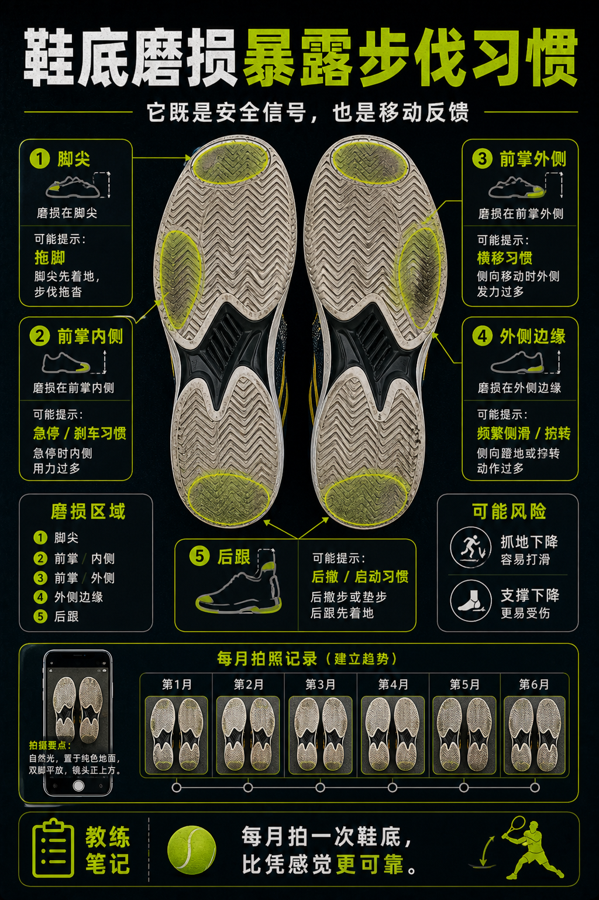

# 鞋底磨损会暴露步伐习惯

> 迁移草稿：保留原文供编辑核对，尚未完成面向球友的通用改写和逐条来源复核。

鞋底磨损位置能提示启动、急停、拖步和重心习惯，也能提醒你何时该换鞋。

## 概念说明

网球鞋磨损不是只看旧不旧。前掌内外侧、脚尖、后跟和外侧边缘的磨损，可能反映你的启动、刹车、拖脚和横移习惯。磨损过度会降低抓地和支撑，增加滑倒或扭伤风险。定期拍照记录鞋底，比凭感觉判断更可靠。

## 配图

## 常见误区（原版素材）

鞋底已经磨平，还继续练急停和横移。

## 理解自测（待编辑）

鞋底磨损为什么既是安全信号，也是步伐反馈？

## 相关词条

- [鞋底纹路要匹配场地](../equipment/equipment.shoe.outsole.md)（supporting）
- [网球鞋要保护横向移动](../equipment/equipment.shoe.support.md)（supporting）

## 来源与审核

- 内容状态：原版标记为 verified（本轮未逐条重新核实）。
- 原始内容：[content/atlas/cards/equipment-deep-dive.json](../../../atlas/cards/equipment-deep-dive.json)；ID：equipment.shoe.wear-pattern。
- 证据类型：verified-source。
- 来源：[How to Choose the Right Tennis Shoes](https://www.tennis-warehouse.com/learning_center/how_to/choosing_the_right_tennis_shoes.html)。
- 原版说明：Supports shoe cards on lateral stability, hard-court durability, clay herringbone outsoles, grass/synthetic-turf grip and selecting shoes by court surface.
- 原版审核：Codex，2026-05-25。
- Wiki 编辑需检查措辞、适用条件、原版个人化断言及来源支持范围。
