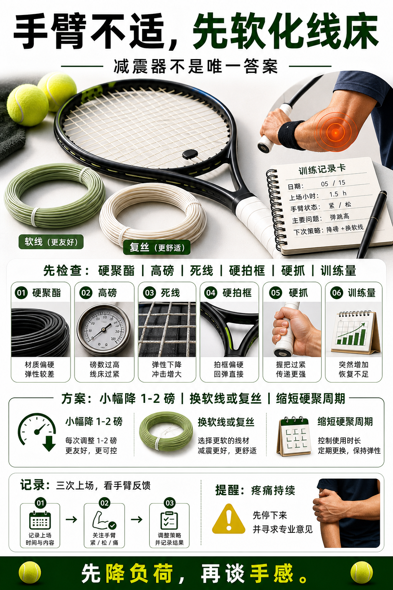

# 手臂不适先软化线床

> 迁移草稿：保留原文供编辑核对，尚未完成面向球友的通用改写和逐条来源复核。

手臂不适时，线种、磅数、硬度和换线周期往往比减震器更值得先检查。

## 概念说明

手臂不适不能只归因于装备，但装备会影响负荷。常见检查顺序是：是否使用过硬聚酯、磅数是否过高、线是否已经死掉、球拍是否过硬、握把是否导致硬抓、训练量是否突然增加。更友好的方案可能是降低磅数、换软线或复丝、缩短硬聚周期、减少连续高强度练习。

## 配图

## 常见误区（原版素材）

手臂疼只装减震器，却继续用死硬线高强度打。

## 理解自测（待编辑）

手臂不适时，为什么线床比减震器更应该优先检查？

## 相关词条

- [减震器主要改声音和手感](../equipment/equipment.accessory.dampener.md)（supporting）
- [硬度 RA 影响力量和手感](../equipment/equipment.racquet.stiffness.md)（supporting）

## 来源与审核

- 内容状态：原版标记为 verified（本轮未逐条重新核实）。
- 原始内容：[content/atlas/cards/equipment-deep-dive.json](../../../atlas/cards/equipment-deep-dive.json)；ID：equipment.string.arm-friendly-setup。
- 证据类型：verified-source。
- 来源：[How to choose the right tennis strings](https://blog.tenniswarehouse-europe.com/lc/StringReference.html?lang=en)。
- 原版说明：Supports the string-system cards on polyester, synthetic gut, natural gut, multifilament, gauge, tension, hybrids, stiffness and comfort tradeoffs.
- 原版审核：Codex，2026-05-25。
- Wiki 编辑需检查措辞、适用条件、原版个人化断言及来源支持范围。
