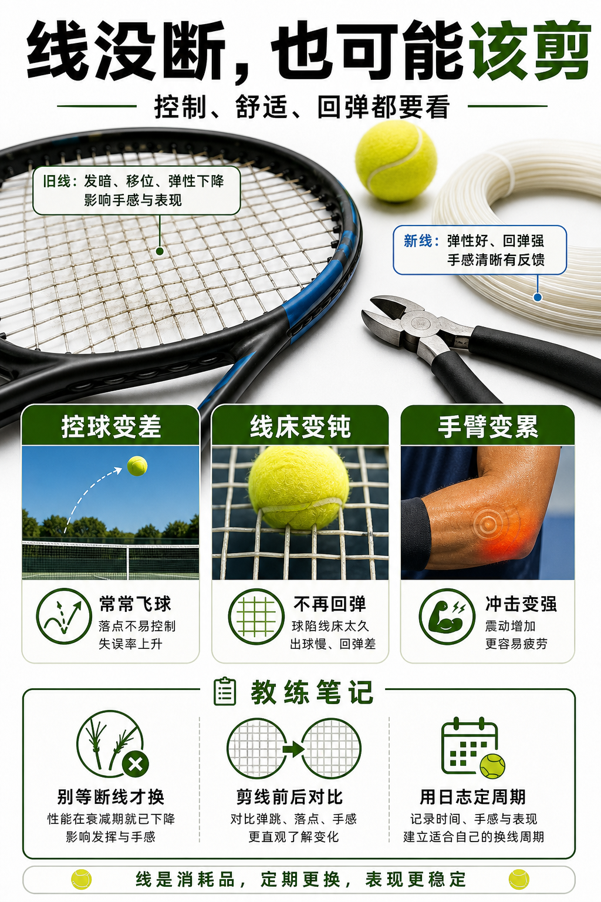

# 什么时候该剪线

> 迁移草稿：保留原文供编辑核对，尚未完成面向球友的通用改写和逐条来源复核。

线不一定要等断了才换，控制、舒适、回弹明显衰减时就该考虑剪线。

## 概念说明

很多爱好者只在断线时换线，但线床可能早就失去原本性能。剪线信号包括：控球突然变差、线床明显变钝、球需要更用力才走、手臂负担增加、线移位严重且不回弹。不同线种周期不同，最可靠的是用使用小时和手感日志建立个人更换节奏。

## 配图

## 常见误区（原版素材）

线不破不换，结果用死线练出硬动作。

## 理解自测（待编辑）

线没断，为什么仍然可能该剪了？

## 相关词条

- [掉磅会让线床换性格](../equipment/equipment.string.tension-loss.md)（prerequisite）
- [线床锁死会偷走旋转](../equipment/equipment.string.locked-stringbed.md)（supporting）

## 来源与审核

- 内容状态：原版标记为 verified（本轮未逐条重新核实）。
- 原始内容：[content/atlas/cards/equipment-deep-dive.json](../../../atlas/cards/equipment-deep-dive.json)；ID：equipment.string.cut-out-timing。
- 证据类型：verified-source。
- 来源：[How to choose the right tennis strings](https://blog.tenniswarehouse-europe.com/lc/StringReference.html?lang=en)。
- 原版说明：Supports the string-system cards on polyester, synthetic gut, natural gut, multifilament, gauge, tension, hybrids, stiffness and comfort tradeoffs.
- 原版审核：Codex，2026-05-25。
- Wiki 编辑需检查措辞、适用条件、原版个人化断言及来源支持范围。
