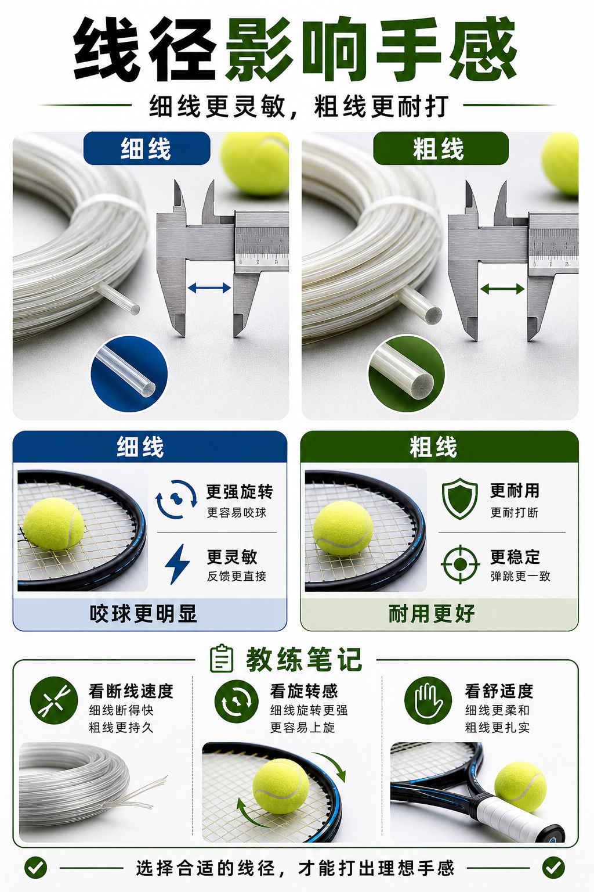

# 线径越细越咬球也越脆

> 迁移草稿：保留原文供编辑核对，尚未完成面向球友的通用改写和逐条来源复核。

线径影响咬球、手感、耐用和断线速度，细线通常更灵敏，粗线通常更耐打。

## 概念说明

线径越细，线床通常更容易形变，触球反馈更灵敏，也更容易带来咬球和旋转感；线径越粗，耐用性通常更好，线床更稳，但手感可能更钝。线径不是独立答案，它要和线种、线床密度、磅数以及你是否容易断线一起决定。

## 配图

## 常见误区（原版素材）

只问线种，不问线径，结果同一条线打出完全不同感觉。

## 理解自测（待编辑）

为什么同一种球线换个线径，手感也可能明显不同？

## 相关词条

- [线床密度影响旋转和控制](../equipment/equipment.racquet.string-pattern.md)（supporting）
- [磅数不是越高越控](../equipment/equipment.string.tension.md)（next）

## 来源与审核

- 内容状态：原版标记为 verified（本轮未逐条重新核实）。
- 原始内容：[content/atlas/cards/equipment-extensions.json](../../../atlas/cards/equipment-extensions.json)；ID：equipment.string.gauge。
- 证据类型：verified-source。
- 来源：[How to choose the right tennis strings](https://blog.tenniswarehouse-europe.com/lc/StringReference.html?lang=en)。
- 原版说明：Supports the string-system cards on polyester, synthetic gut, natural gut, multifilament, gauge, tension, hybrids, stiffness and comfort tradeoffs.
- 原版审核：Codex，2026-05-25。
- Wiki 编辑需检查措辞、适用条件、原版个人化断言及来源支持范围。
