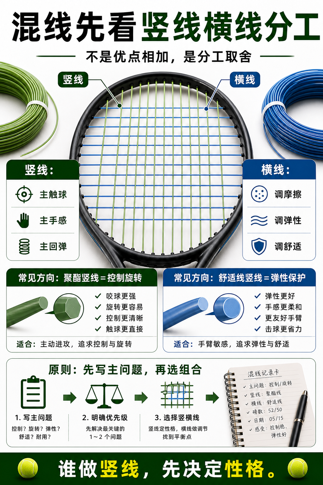

# 混线先看竖线横线分工

> 迁移草稿：保留原文供编辑核对，尚未完成面向球友的通用改写和逐条来源复核。

混线时竖线更主导主要击球性格，横线常用于调节滑动、弹性和舒适。

## 概念说明

混线不是把两条线优点简单相加。竖线承担更多主触球和滑动回弹作用，往往决定主要手感；横线会影响线床摩擦、弹性、舒适和耐用。聚酯做竖线通常更偏控制和旋转，舒适线做竖线通常更偏弹性和保护。先定义主问题，再选择竖横线组合。

## 配图

## 常见误区（原版素材）

复制混线方案，却不知道竖横线各解决什么。

## 理解自测（待编辑）

混线里为什么要先决定谁做竖线？

## 相关词条

- [混线是在组合取舍](../equipment/equipment.string.hybrid.md)（prerequisite）
- [Snapback 是线的回弹](../equipment/equipment.string.snapback.md)（supporting）

## 来源与审核

- 内容状态：原版标记为 verified（本轮未逐条重新核实）。
- 原始内容：[content/atlas/cards/equipment-deep-dive.json](../../../atlas/cards/equipment-deep-dive.json)；ID：equipment.string.hybrid-main-cross。
- 证据类型：verified-source。
- 来源：[How to choose the right tennis strings](https://blog.tenniswarehouse-europe.com/lc/StringReference.html?lang=en)。
- 原版说明：Supports the string-system cards on polyester, synthetic gut, natural gut, multifilament, gauge, tension, hybrids, stiffness and comfort tradeoffs.
- 原版审核：Codex，2026-05-25。
- Wiki 编辑需检查措辞、适用条件、原版个人化断言及来源支持范围。
