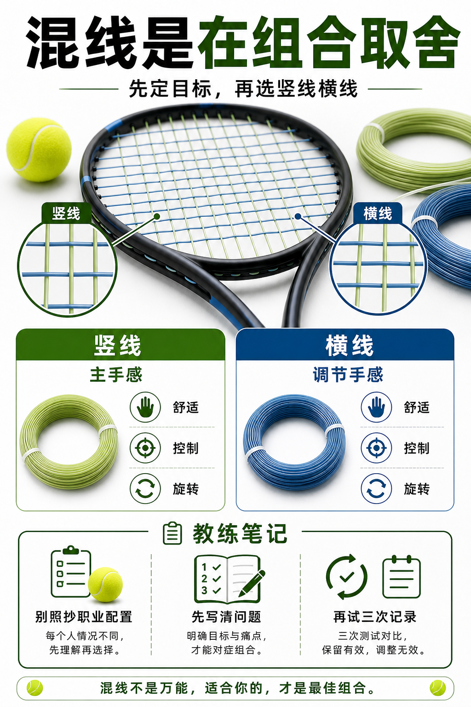

# 混线是在组合取舍

> 迁移草稿：保留原文供编辑核对，尚未完成面向球友的通用改写和逐条来源复核。

混线用不同竖线和横线组合旋转、控制、弹性、舒适和耐用，不是简单叠加优点。

## 概念说明

混线通常用竖线决定主要触球性格，横线调节舒适、弹性和线床反应。比如聚酯搭配复丝或天然肠，可以在控制与舒适之间找平衡；但混线也会带来更复杂的掉磅、磨损和手感变化。只有当你已经知道单一线种的问题在哪里，混线才更有意义。

## 配图

## 常见误区（原版素材）

听到职业配置就照抄，不知道竖线横线各承担什么。

## 理解自测（待编辑）

混线之前，为什么要先知道单线到底哪里不满足你？

## 相关词条

- [聚酯线给旋转也给门槛](../equipment/equipment.string.poly.md)（prerequisite）
- [天然肠和复丝主打弹性舒适](../equipment/equipment.string.natural-gut-multi.md)（supporting）

## 来源与审核

- 内容状态：原版标记为 verified（本轮未逐条重新核实）。
- 原始内容：[content/atlas/cards/equipment-extensions.json](../../../atlas/cards/equipment-extensions.json)；ID：equipment.string.hybrid。
- 证据类型：verified-source。
- 来源：[How to choose the right tennis strings](https://blog.tenniswarehouse-europe.com/lc/StringReference.html?lang=en)。
- 原版说明：Supports the string-system cards on polyester, synthetic gut, natural gut, multifilament, gauge, tension, hybrids, stiffness and comfort tradeoffs.
- 原版审核：Codex，2026-05-25。
- Wiki 编辑需检查措辞、适用条件、原版个人化断言及来源支持范围。
