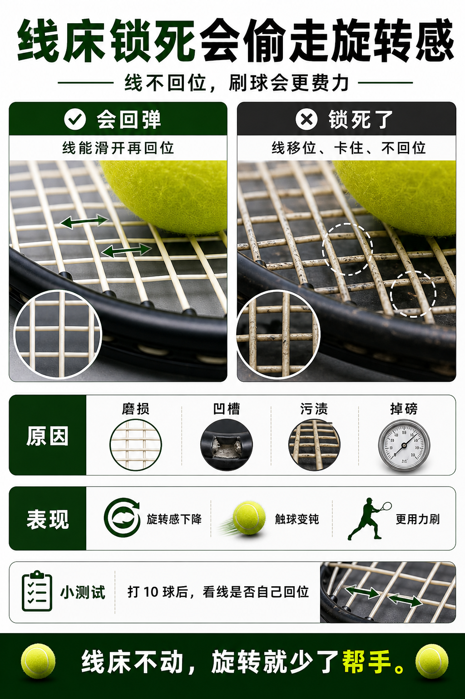

# 线床锁死会偷走旋转

> 迁移草稿：保留原文供编辑核对，尚未完成面向球友的通用改写和逐条来源复核。

线不能顺畅滑动回弹时，旋转潜力和触球反馈都会下降。

## 概念说明

现代上旋部分依赖线床咬球、滑动和回弹。随着磨损、凹槽、污渍和张力变化，球线可能卡住不回位，线床变得钝、死、旋转感下降。这就是常说的线床锁死。它不一定肉眼立刻明显，但你会感觉球不再容易带弧线，必须更用力刷。

## 配图

## 常见误区（原版素材）

继续用锁死线床练上旋，越练越硬。

## 理解自测（待编辑）

为什么线床锁死后，上旋会更费力？

## 相关词条

- [Snapback 是线的回弹](../equipment/equipment.string.snapback.md)（prerequisite）
- [什么时候该剪线](../equipment/equipment.string.cut-out-timing.md)（application）

## 来源与审核

- 内容状态：原版标记为 verified（本轮未逐条重新核实）。
- 原始内容：[content/atlas/cards/equipment-deep-dive.json](../../../atlas/cards/equipment-deep-dive.json)；ID：equipment.string.locked-stringbed。
- 证据类型：verified-source。
- 来源：[How to choose the right tennis strings](https://blog.tenniswarehouse-europe.com/lc/StringReference.html?lang=en)。
- 原版说明：Supports the string-system cards on polyester, synthetic gut, natural gut, multifilament, gauge, tension, hybrids, stiffness and comfort tradeoffs.
- 原版审核：Codex，2026-05-25。
- Wiki 编辑需检查措辞、适用条件、原版个人化断言及来源支持范围。
