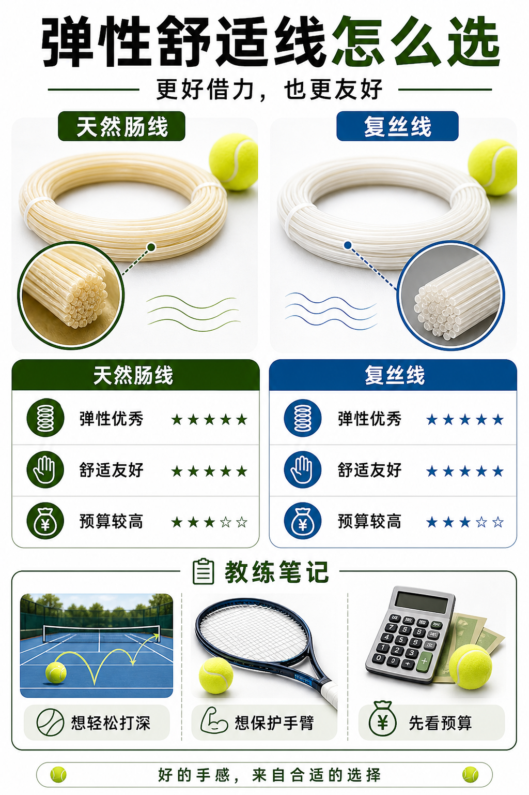

# 天然肠和复丝主打弹性舒适

> 迁移草稿：保留原文供编辑核对，尚未完成面向球友的通用改写和逐条来源复核。

天然肠线和复丝线通常更弹、更舒服，适合重视手感、深度和手臂保护的人。

## 概念说明

天然肠线以弹性、保磅和舒适著称，但价格高、维护要求也高；复丝线用多股纤维模拟柔软和弹性，成本更低，是舒适取向的常见选择。它们通常不如聚酯线耐磨和强控，但能让球更容易打深，手臂负担更小。对需要保护手臂或想要轻松深度的人，这类线值得认真考虑。

## 配图

## 常见误区（原版素材）

把舒服误解成低级，忽略自己手臂和挥速的现实条件。

## 理解自测（待编辑）

舒服的线为什么可能帮助你进步，而不是拖慢你？

## 相关词条

- [混线是在组合取舍](../equipment/equipment.string.hybrid.md)（supporting）
- [磅数不是越高越控](../equipment/equipment.string.tension.md)（supporting）

## 来源与审核

- 内容状态：原版标记为 verified（本轮未逐条重新核实）。
- 原始内容：[content/atlas/cards/equipment-extensions.json](../../../atlas/cards/equipment-extensions.json)；ID：equipment.string.natural-gut-multi。
- 证据类型：verified-source。
- 来源：[How to choose the right tennis strings](https://blog.tenniswarehouse-europe.com/lc/StringReference.html?lang=en)。
- 原版说明：Supports the string-system cards on polyester, synthetic gut, natural gut, multifilament, gauge, tension, hybrids, stiffness and comfort tradeoffs.
- 原版审核：Codex，2026-05-25。
- Wiki 编辑需检查措辞、适用条件、原版个人化断言及来源支持范围。
