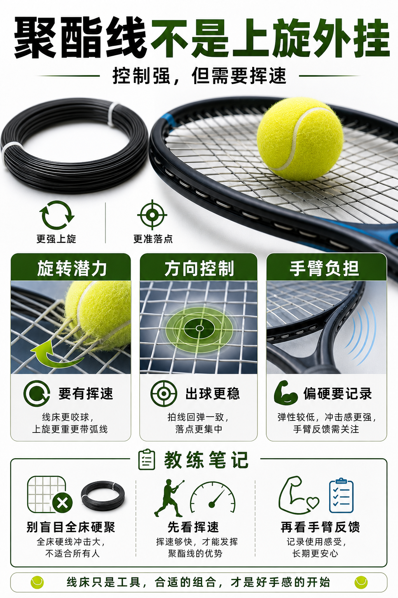

# 聚酯线给旋转也给门槛

> 迁移草稿：保留原文供编辑核对，尚未完成面向球友的通用改写和逐条来源复核。

聚酯线常被用来获得控制和旋转潜力，但它更硬、更吃挥速，也更需要关注手臂负担。

## 概念说明

聚酯线的优势通常在控制、耐用和旋转潜力，尤其适合挥速足、能主动刷球的人。它的代价是手感偏硬、弹性衰减后容易变钝，对手臂不一定友好。初学和中低阶球员如果挥速不足，聚酯线未必能自动带来旋转，反而可能让球浅、手臂紧、失误多。

## 配图

## 常见误区（原版素材）

看到职业球员用聚酯线，就以为自己也应该全床硬聚。

## 理解自测（待编辑）

聚酯线为什么不是“上旋外挂”？

## 相关词条

- [磅数不是越高越控](../equipment/equipment.string.tension.md)（supporting）
- [混线是在组合取舍](../equipment/equipment.string.hybrid.md)（next）

## 来源与审核

- 内容状态：原版标记为 verified（本轮未逐条重新核实）。
- 原始内容：[content/atlas/cards/equipment-extensions.json](../../../atlas/cards/equipment-extensions.json)；ID：equipment.string.poly。
- 证据类型：verified-source。
- 来源：[How to choose the right tennis strings](https://blog.tenniswarehouse-europe.com/lc/StringReference.html?lang=en)。
- 原版说明：Supports the string-system cards on polyester, synthetic gut, natural gut, multifilament, gauge, tension, hybrids, stiffness and comfort tradeoffs.
- 原版审核：Codex，2026-05-25。
- Wiki 编辑需检查措辞、适用条件、原版个人化断言及来源支持范围。
