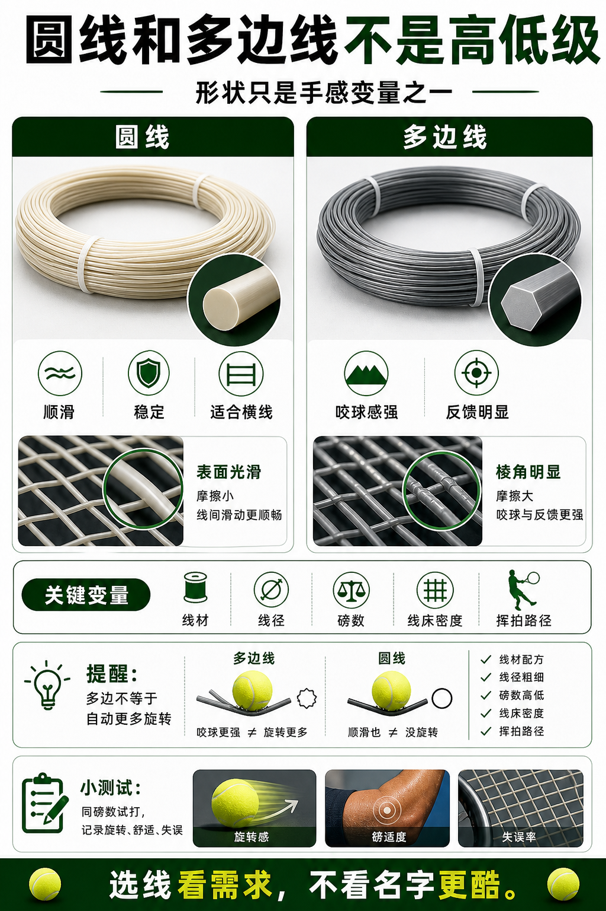

# 圆线和多边线不是高低级

> 迁移草稿：保留原文供编辑核对，尚未完成面向球友的通用改写和逐条来源复核。

多边线可能提供更强咬球感，圆线通常更顺滑稳定，选择取决于手感和耐用需求。

## 概念说明

多边线通过棱角提供更明显的咬球感，常被用于追求旋转反馈；圆线摩擦更顺滑，可能更稳定、耐用或更适合混线横线。多边不等于一定更会转，圆线也不等于没旋转。实际效果取决于线材、线径、磅数、线床密度和你的挥拍路径。

## 配图

## 常见误区（原版素材）

为了旋转盲目上硬多边线，结果手臂紧、球浅。

## 理解自测（待编辑）

为什么多边线不等于自动更多旋转？

## 相关词条

- [聚酯线给旋转也给门槛](../equipment/equipment.string.poly.md)（supporting）
- [线径越细越咬球也越脆](../equipment/equipment.string.gauge.md)（supporting）

## 来源与审核

- 内容状态：原版标记为 verified（本轮未逐条重新核实）。
- 原始内容：[content/atlas/cards/equipment-deep-dive.json](../../../atlas/cards/equipment-deep-dive.json)；ID：equipment.string.round-vs-shaped。
- 证据类型：verified-source。
- 来源：[How to choose the right tennis strings](https://blog.tenniswarehouse-europe.com/lc/StringReference.html?lang=en)。
- 原版说明：Supports the string-system cards on polyester, synthetic gut, natural gut, multifilament, gauge, tension, hybrids, stiffness and comfort tradeoffs.
- 原版审核：Codex，2026-05-25。
- Wiki 编辑需检查措辞、适用条件、原版个人化断言及来源支持范围。
